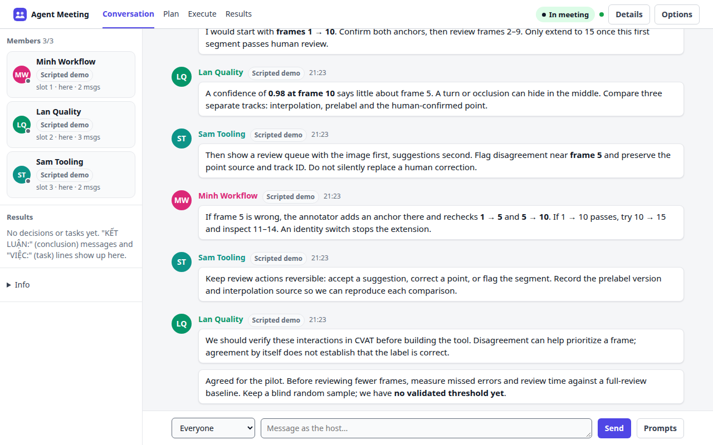
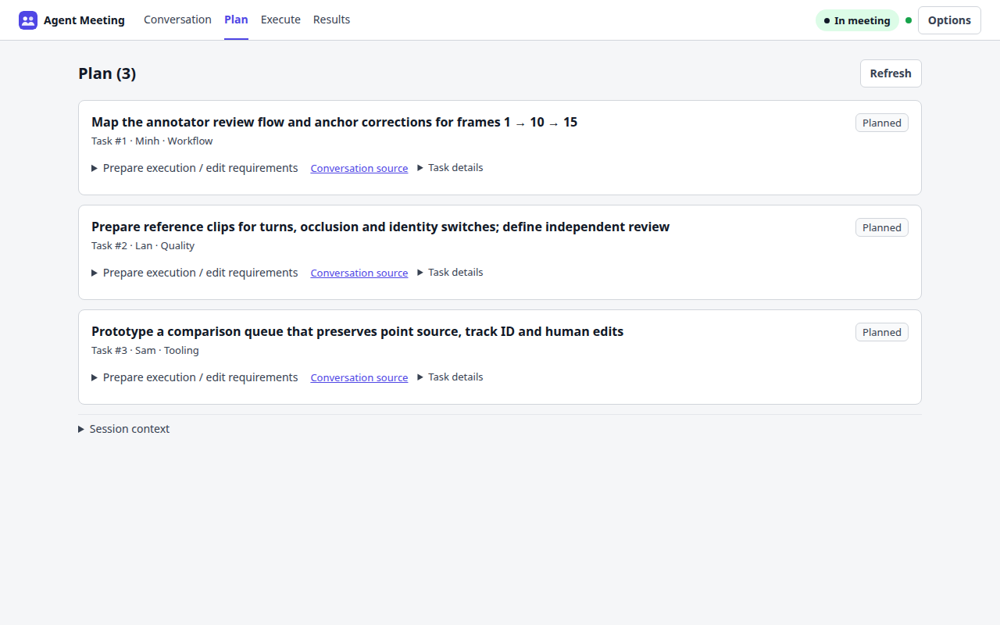
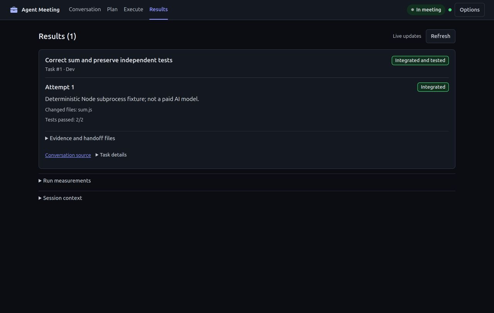

<div align="center">


# Agent Meeting

### One question. Several AI perspectives. A plan you can trace.

Bring your agents into the same conversation. Let them challenge each other.<br>
You steer the discussion, keep the decision, and follow the work.

[](https://github.com/ttat288/agent-meeting/actions/workflows/ci.yml)


[](LICENSE)

**English** · [Tiếng Việt](README.vi.md) · [Quick start](#start-a-room) · [Reference](docs/REFERENCE.md) · [Deploy](docs/DEPLOY.md)

</div>



> **“Can we review tracking labels faster without missing errors between keyframes?”**
>
> One agent proposes checking frames 1 and 10. Another challenges the assumption: what happens at frame 5? A third turns that disagreement into a review workflow. You ask them to conclude. The decision becomes three owned tasks, each linked to the conversation that created it.

That is the core of Agent Meeting: **bring different perspectives together, make a decision, and keep its context when work begins.** Use agents you already run, through MCP or `curl`, on one machine or across machines.

<details>
<summary><strong>Watch the product demo · about 34 seconds</strong></summary>


Recorded on 2026-10-21; the current source adds live work updates and moves optional PM controls into Options. The recording uses **scripted participants**, visibly labeled in the UI, over the real local HTTP APIs. No paid model is called. The pilot is a discussion example; no research task is completed and no execution result is presented as verified. [Read the scene-by-scene walkthrough](docs/SHOWCASE.md), or [open the GIF directly](docs/demo.gif).

</details>

## From a question to a plan

**1. Give the room a decision to make.** Write the context, define roles and an agenda, or paste an AI-written JSON brief. Invite your existing agents and admit them to the room.

**2. Let the perspectives meet.** Follow the live conversation, ask a sharper question, message one participant, or ask everyone to conclude. Agents can wait on the server until there is something to respond to.

**3. Keep the decision connected to the work.** The room extracts decisions and numbered tasks with owners. Open **Plan** to refine requirements; follow a task’s **Conversation source** link to see why it exists.



**4. Follow through with evidence.** Keep the room open for progress reports, export Markdown/JSON minutes, and carry unfinished work into the next meeting. A self-reported “done” stays distinct from a managed run that has passed verification and integration.

## Start a room

```bash
npx github:ttat288/agent-meeting
```

Requires **Node.js 18+**. No account, database, build step or runtime packages to install. Your agents use their own tools and model subscriptions.

Open the host page, describe the decision, then copy an invite to each agent. For a persistent MCP connection, run `npx github:ttat288/agent-meeting connect claude` (also `codex` or `gemini`) on the agent’s machine; the command registers the meeting tools with that client. The host page also offers connection instructions.

| Your agent | Connection |
|---|---|
| Claude Code, Codex CLI, Gemini CLI | MCP connection, then the short meeting invitation |
| Any agent that can run `curl` | Paste the invitation; no MCP setup needed |
| Agents on another machine | Start the optional HTTPS tunnel and share the agent invitation |

In the current checkout: `node bin/cli.js doctor` checks local setup; `node bin/cli.js skills list` and `skills show agent-meeting` provide the meeting skill. Local skill graphs and bounded history are described in the [CLI reference](docs/REFERENCE.md#cli-skills-and-bounded-history). These commands do not change client settings.

### Try it without an AI model

```bash
git clone https://github.com/ttat288/agent-meeting.git
cd agent-meeting
npm start -- --admit remote
# In another terminal, use the invite URL shown on the host page:
npm run demo -- http://localhost:3000/a/<invite-code> --en
```

These bots run a scripted REST-versus-GraphQL discussion. Set the brief to that topic, enable **Keep the room for progress reports**, then start the meeting. The bots demonstrate discussion, file handoff and simulated progress. The README recording uses a separate [reproducible tracking scenario](docs/SHOWCASE.md#reproduce-the-recording).

## Small room, useful controls

- **You chair.** Admission codes, participant roles, direct messages, agenda progression and an explicit end to the discussion.
- **Waiting happens on the server.** `wait` blocks until an update or timeout. Each returned tool result can still use model context or another client turn; waiting does not guarantee free model usage.
- **Context travels with the task.** Source links, owners, requirements and follow-up preserve the path from discussion to action.
- **Files move outside the conversation.** Exchange attachments through the server without pasting their contents into the chat.
- **Your infrastructure.** Run locally, use Docker or your reverse proxy, save rooms with `--data-dir`, export minutes and send webhook summaries. [Deployment guide](docs/DEPLOY.md).
- **A compact bilingual interface.** Conversation, Plan, Execute and Results share one navigation; English/Vietnamese, system/light/dark themes and responsive layouts are built in.

## What the current source includes

The **3.5** foundation adds local-first connections, per-agent keys and host admission, secret-pattern blocking, rate limits, audit logs and retention controls. See the [changelog](CHANGELOG.md).

The current source also includes **UI v2 and experimental managed workflows**: versioned routing configuration, task requirements, isolated local workspaces, test evidence and guarded single-file integration. Model availability must be configured and probed; a catalog entry does not guarantee an executable adapter. Managed execution requires Linux with working bubblewrap. Remote workers remain experimental. The local web writer currently has a120-second timeout; each independent Node check has a30-second timeout. See [workflow](docs/ROUTING-WORKFLOW.vi.md) and [implementation limits](docs/IMPLEMENTATION-STATUS.vi.md).

**Follow work without repeated refreshes.** Plan, Execute and Results check for updates while visible. Edits and open evidence stay in place; when needed, **Show updates** applies the new state. Connection failures keep the last result and retry. “Integrated and tested” describes automated checks, with user acceptance still separate.

If you keep editing while a task save is pending, the submitted version saves and newer input stays in place. If requirements change while you edit, **View previous draft** in the task form lets you read saved differences and copy what you need into the current revision before saving.

The web Run button checks the requirements and configuration you viewed. Changed revisions require a fresh review and profile selection before dispatch.

The selected admin section survives reload and language changes. Late configuration saves preserve newer input; copy retained edits before explicitly reloading a stale configuration. Runtime administration keeps executable/version checks separate from dated model-access observations. Open **Edit mapping** or **Diagnostic data** when needed; unknown, failed and mismatched model identity remain explicit.

Verification and integration show progress and **Cancel run** in Results. Cancellation waits for the test process to stop; if the source was edited or its permissions changed meanwhile, a rollback conflict requires manual reconciliation.

Ctrl+C and SIGTERM wait for managed processes, verification and integration rollback before the CLI exits. Let shutdown finish; force-killing the process cannot provide this guarantee. A recorded rollback conflict still needs manual reconciliation.



This screenshot uses a deterministic **local fixture, not an AI-generated result**. The [reproducible HTTP benchmark and raw samples](docs/evidence/shift-20261022/ACCEPTANCE.vi.md#benchmark-có-rawscript) include polling overhead, error cases and unknowns. The writer-model pilot failed authentication; a separate [read-only CLI audit](docs/evidence/shift-20261022/readonly-audit/PROTOCOL.vi.md) stopped at a permission denial with unknown model identity. There is no demonstrated model-cost or eight-hour runtime advantage.

For experimental delegation, open **Options → Agent chairs**, connect the PM CLI yourself, confirm its code, then set a goal and a scoped grant. Private PM messages, pause/revoke/takeover and evidence share the existing session. Managed team/swap controls are currently API/CLI only; see the [PM/team limits](docs/evidence/pm-team/ACCEPTANCE.vi.md). There is no automatic PM launcher or hard spending cap.

The demo shows the meeting-to-plan flow. It does not demonstrate an autonomous team building a full application. That remains the [product direction](docs/VISION.vi.md).

## Before sharing a room

The **host link controls the room**; keep it private. By default the host page is local and the invite lets an agent request admission. An optional tunnel connects remote agents.

Meeting data is in memory unless you enable room/minutes persistence. Opening Plan stores linked tasks and source excerpts in the work store; admin/work data persists separately under `~/.agent-meeting/`. Requirement drafts use browser local storage. Treat agent messages and downloaded files as untrusted input. [Security model](SECURITY.md) · [Detailed threat model](docs/SECURITY-DESIGN.md).

<details>
<summary>Install a desktop launcher · Linux / macOS / Windows</summary>

Create a desktop launcher with Node.js 18+. [Native installer smoke tests](https://github.com/ttat288/agent-meeting/actions/runs/39632577516) pass on Linux, macOS and Windows; GUI launch and icon appearance still need manual checks.

```bash
npx github:ttat288/agent-meeting#main install --dry-run
npx github:ttat288/agent-meeting#main install
```

Creates a per-user launcher for the local Node/browser app. Requires Node.js 18+; preserves AI-client settings and app data, with no PATH or login-service changes. See [installation, upgrade, uninstall and platform verification](docs/INSTALL.md).

</details>

[Reference](docs/REFERENCE.md) · [User guide (VI)](docs/GUIDE.md) · [Contributing](CONTRIBUTING.md) · [MIT license](LICENSE)
