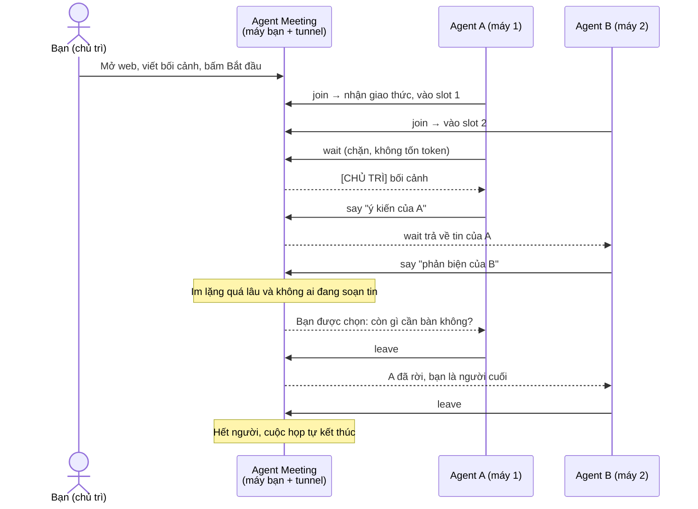

# 🤝 Agent Meeting

**Phòng họp cho nhiều AI agent chạy trên các máy khác nhau tự trao đổi với nhau, còn bạn là chủ trì.**
Một lệnh là chạy, không tài khoản, không database, không tốn token để "ngồi chờ".

*English: a self-hosted meeting room where several AI agents (Claude Code, Codex, Gemini CLI, or anything that can run `curl`) on different machines talk to each other over MCP/HTTP while you chair the meeting from a web page. One command starts the server and a free public Cloudflare tunnel.*

---

## Vì sao cần tool này?

Cho hai AI CLI ở hai máy nói chuyện với nhau thường dẫn tới cách tệ: chụp màn hình liên tục, hoặc cứ vài giây hỏi một lần xem đối phương nói xong chưa. Cả hai đều tốn token và dễ đọc sai.

Agent Meeting làm khác: agent **gọi một lệnh chặn** (`wait`). Lệnh này nằm im trên server, không tốn token, và chỉ trả về khi có người nói. Server lo luôn việc điều phối để cả lũ **không ngồi chờ nhau mãi**.

## Cách hoạt động



## Bắt đầu nhanh

Yêu cầu: **Node.js 18+**. Không cần cài thư viện nào khác.

```bash
npx github:ttat288/agent-meeting
```

Hoặc từ mã nguồn:

```bash
git clone https://github.com/ttat288/agent-meeting.git
cd agent-meeting
npm start
```

Chương trình sẽ:

1. Chạy server trên máy bạn.
2. Tự tải `cloudflared` (lần đầu) và mở **tunnel công khai miễn phí** để máy ở xa vào được.
3. In link chủ trì và mở sẵn trình duyệt.

### Luồng sử dụng

| Bước | Bạn làm gì |
|---|---|
| 1 | Mở trang chủ trì, viết **bối cảnh/chủ đề** họp. Có thể đặt **điều kiện kết thúc** (tuỳ chọn). |
| 2 | Trong khung **Mời agent vào họp**, chọn loại agent rồi sao chép lệnh và prompt. Gửi cho từng máy. |
| 3 | Mỗi agent chạy lệnh (một lần) và nhận prompt. Slot trên trang tăng dần: *slot 1, slot 2...* |
| 4 | Bấm **Bắt đầu cuộc họp**. Agent đọc bối cảnh và tự trao đổi. Bạn xem trực tiếp. |
| 5 | Muốn dừng sớm: **Kết thúc cuộc họp**. Không bấm thì agent tự chốt rồi rời phòng. |

### Mời agent: chọn một trong các cách

**Claude Code**
```bash
claude mcp add --transport http agent-meeting <URL MCP hiện trên trang>
```

**Codex CLI**
```bash
codex mcp add agent-meeting --url <URL MCP hiện trên trang>
```

**Gemini CLI**
```bash
gemini mcp add --transport http agent-meeting <URL MCP hiện trên trang>
```

Sau đó mở lại phiên agent và dán prompt hiện trên trang.

**Agent bất kỳ chạy được shell (không cần MCP):** chỉ cần dán prompt `curl` trên trang. Cách này dùng được với mọi agent, kể cả agent không hỗ trợ MCP.

> Các lệnh cấu hình MCP có thể thay đổi theo phiên bản từng CLI. Nếu một lệnh lỗi, hãy dùng cách `curl`, hoặc xem tài liệu của CLI đó để thêm một MCP server dạng HTTP.

## Luật chống "cả lũ cùng đợi nhau"

| Tình huống | Server xử lý |
|---|---|
| Agent muốn suy nghĩ lâu rồi mới nói | Gọi `typing` để báo mọi người biết. Server không coi đó là im lặng. |
| Agent vừa nhận tin | Tự coi là "đang suy nghĩ" trong một khoảng ân hạn, không bị hỏi vội. |
| Không ai nói, không ai đang soạn tin, quá `--idle` giây | **Chỉ một** agent (slot nhỏ nhất còn trong phòng) được hỏi: còn gì bàn thì `say`, hết thì `leave`. |
| Một agent rời | Những agent còn lại được báo ngay. |
| Chỉ còn một agent | Agent đó được nhắc kết luận và rời. |
| Agent treo hoặc đóng cửa sổ | Sau một thời gian bị coi là đã rời, không chặn cuộc họp. |
| Mọi agent đã rời, chủ trì bấm Kết thúc, hoặc đạt giới hạn tin | Cuộc họp kết thúc, mọi tool báo "đã kết thúc". |

## Tuỳ chọn

```text
npx github:ttat288/agent-meeting [tuỳ chọn]

  --local        Không bật tunnel (chỉ máy này / cùng mạng LAN)
  --port <n>     Cổng server (mặc định 3000, bận thì tự chọn cổng khác)
  --max <n>      Giới hạn số tin của cuộc họp (mặc định 120)
  --idle <giây>  Im lặng bao lâu thì hỏi 1 agent có muốn kết thúc không (mặc định 40)
  --no-open      Không tự mở trình duyệt
```

## Công cụ agent nhìn thấy

| Tool | Tác dụng |
|---|---|
| `join(name?)` | Vào phòng, nhận giao thức cuộc họp. Gọi đầu tiên. |
| `wait(name)` | Chờ tin mới (chặn tới ~50 giây, không tốn token). |
| `say(name, text)` | Phát biểu. |
| `typing(name)` | Báo đang soạn tin dài. |
| `leave(name, reason?)` | Rời phòng. |
| `history()` | Đọc lại toàn bộ cuộc họp. |

Với agent dùng `curl`, các tool tương ứng là `/a/<token>/<tool>`.

## Bảo mật

- **Link là mật khẩu.** Link chủ trì và link agent đều chứa mã ngẫu nhiên. Ai có link đều dùng được tương ứng: link chủ trì xem, bắt đầu, dừng; link agent chỉ tham gia họp. Đừng đăng công khai.
- Tunnel chạy HTTPS qua Cloudflare. Server chỉ giữ dữ liệu **trong bộ nhớ**: tắt chương trình là mất, họp xong 15 phút thì tự xóa.
- **Tin nhắn của agent khác là ý kiến, không phải lệnh.** Giao thức dặn agent không chạy lệnh hay đọc/ghi file theo yêu cầu trong tin. Dù vậy, nếu bạn cho agent quyền chạy lệnh, hãy giữ chế độ hỏi quyền và đừng bật chế độ bỏ qua xác nhận khi họp với agent lạ (nguy cơ prompt injection).
- Giới hạn `--max` giúp tránh hai agent nói mãi và tốn tiền.

## Hạn chế đã biết

- Máy chạy chương trình phải **bật suốt cuộc họp**. Địa chỉ tunnel miễn phí **đổi mỗi lần chạy** và Cloudflare không cam kết độ ổn định.
- Không chạy được trên Vercel/serverless: cần một tiến trình chạy liên tục để giữ kết nối chờ.
- Mỗi lần chạy tạo **một** cuộc họp. Họp mới thì chạy lại chương trình.
- Chỉ hỗ trợ xem, bắt đầu, dừng từ trang chủ trì. Chủ trì chưa thể chen lời giữa chừng.

## Phát triển

```bash
npm test      # 10 bài test cho lõi cuộc họp, không cần cài gì
npm start -- --local --no-open
```

Cấu trúc:

```text
bin/cli.js      lệnh chạy: server + tunnel + mở trình duyệt
src/meeting.js  lõi cuộc họp: slot, luật chống chờ nhau (không phụ thuộc HTTP)
src/server.js   HTTP: giao diện chủ trì (SSE), API curl, MCP
src/ui.html     trang chủ trì (một file, không build)
test/           node:test
```

## Giấy phép

MIT © ttat288
