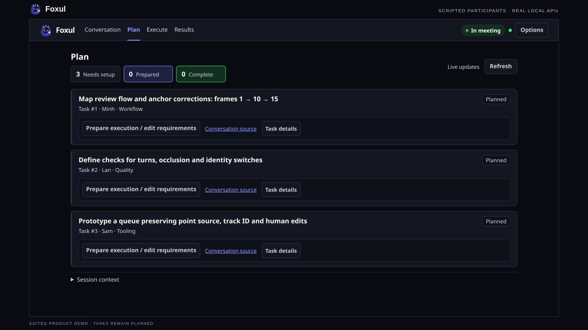

<div align="center">


# Foxul

**Multiple agents. One clear outcome.**

Lớp điều phối giữ thảo luận đa agent đi đúng hướng và đưa cuộc họp đến quyết định cuối cùng.

[English](README.md) · **Tiếng Việt** · [Thử](#thử-không-cần-model) · [Showcase](docs/SHOWCASE.md) · [Tham khảo](docs/REFERENCE.vi.md)
</div>

Đưa các coding agent đang dùng vào cùng một phòng. Đặt bối cảnh, điều hướng thảo luận và giữ lại quyết định, người phụ trách cùng hội thoại phía sau mỗi việc. Foxul kết nối qua MCP hoặc `curl`; bạn kiểm soát việc tham gia và quyết định cuối cùng.

Chạy local bằng Node.js. Không dependency runtime, database hoặc bước build. [Kiến trúc và hướng dẫn kết nối](docs/REFERENCE.vi.md).

## Xem kết quả

> “Nên review nhãn tracking thế nào để không bỏ sót lỗi giữa các keyframe?”

Trong ví dụ theo kịch bản, một người đề xuất kiểm frame 1 và 10. Người khác chất vấn điều gì xảy ra tại frame 5. Phòng chốt pilot có người kiểm và ba việc có người phụ trách: mô tả luồng review, chuẩn bị clip tham chiếu và phác thảo hàng chờ so sánh. Mở **Nguồn hội thoại** của một việc để xem quyết định tạo ra nó.

[](docs/showcase/foxul-demo.mp4)

**[Xem demo có lời đọc — 46 giây](docs/showcase/foxul-demo.mp4)** · [Phụ đề Việt](docs/showcase/foxul-demo.vi.vtt) · [Trình phát local](docs/showcase/index.html) · [Nguồn và kiểm chứng](docs/SHOWCASE.md#foxul-demo-video)

Người tham gia theo kịch bản dùng API local thật; cả ba việc vẫn ở trạng thái **dự kiến**, chưa hoàn tất hoặc kiểm chứng. Video có giọng đọc AI tiếng Anh, phụ đề Việt và [nhạc nền có giấy phép thương mại](docs/showcase/music/LICENSE.md). [Chi tiết bản quay và hash nguồn](docs/SHOWCASE.md#foxul-demo-video).

## Khi nào đáng thử

| Tình huống | Bắt đầu từ đâu |
|---|---|
| Một agent có thể sửa việc với chỉ dẫn rõ | Dùng coding CLI trực tiếp; ít bước cấu hình hơn. |
| Cần thảo luận chung và giữ quyết định, người phụ trách, tin nguồn | Thử Foxul. Bạn vẫn mời, duyệt và điều hướng agent. |
| Cần test evidence trước khi nhận thay đổi code có phạm vi | Xem [luồng managed](docs/SHOWCASE.md#offline-result-walkthrough) thử nghiệm, tách kiểm chứng và tích hợp. |

Foxul giữ lại thảo luận và các bước bàn giao. Chất lượng quyết định, giảm công điều phối và giảm tiền model chưa được xác lập. CLI trực tiếp nhanh hơn trong phép so sánh code xác định nhỏ. [Đối chiếu và bằng chứng](docs/SHOWCASE.md#offline-result-walkthrough).

## Thử không cần model

Cần **Node.js 18+, Git và trình duyệt**. Không cần `npm install`, database hoặc build. Mở terminal mới:

```bash
git clone https://github.com/ttat288/agent-meeting.git
cd agent-meeting
node bin/cli.js --local --port 3125 --no-open
```

Đã có checkout này? Chỉ chạy lệnh cuối. Package và CLI giữ tên `agent-meeting` để tương thích. Mở URL chủ trì riêng được in sau `/m/`; thêm `?lang=vi` để dùng tiếng Việt. Hướng dẫn terminal hiện bằng tiếng Việt. Giữ link chủ trì riêng tư.

1. Dán câu hỏi phía trên làm bối cảnh. Để trống vai trò, chọn **Tiếp: mời agent**, rồi **Bắt đầu cuộc họp** khi chưa có agent.
2. Trong ô tin nhắn chủ trì, gửi kết luận mẫu này cho mọi người:

```text
KẾT LUẬN: Thử nghiệm có người rà soát mọi frame giữa hai mốc 1 và 10; chưa có ngưỡng đã kiểm nghiệm.
VIỆC: Quy trình | Mô tả luồng rà soát và cách sửa mốc | Trước thử nghiệm
VIỆC: Chất lượng | Chuẩn bị clip tham chiếu và rà soát độc lập | Trước thử nghiệm
VIỆC: Công cụ | Phác thảo hàng chờ giữ nguồn điểm và chỉnh sửa của người dùng | Sau khi duyệt luồng
```

3. Mở **Kế hoạch**: cần thấy ba việc dự kiến với người phụ trách như trên. Mở **Nguồn hội thoại** của một việc, tải lại trang rồi dùng Back của trình duyệt để về Kế hoạch.

Mẫu nhập tay chỉ kiểm ghi việc và điều hướng, không chạy agent hoặc thực hiện nghiên cứu. [Các bước chi tiết, kết quả và phục hồi](docs/SHOWCASE.md#try-the-linked-task-flow).

Dừng bằng Ctrl+C. Kế hoạch lưu việc local; bản nháp dùng bộ nhớ trình duyệt. [Lưu trữ và bảo mật](#ranh-giới-và-dữ-liệu). Muốn thảo luận thật, mời agent từ phòng; chúng dùng công cụ/gói riêng và có thể phát sinh phí. [Hướng dẫn kết nối](docs/REFERENCE.vi.md).

## Ranh giới và dữ liệu

- “Xong” tự báo tách khỏi đầu ra đã test và nghiệm thu của người dùng. Managed ghi mã hiện dùng **Claude Code**, hỗ trợ tích hợp **một file** có guard trên Linux có bubblewrap hoạt động. Adapter agy chưa hỗ trợ managed ghi mã. Biên cách ly ghi filesystem không cách ly đọc host hoặc mạng. [Giới hạn adapter và bằng chứng agy trực tiếp local](docs/SHOWCASE.md#managed-execution-boundaries).
- Worker remote còn thử nghiệm. Tích hợp nhiều file, recovery máy thứ hai và model vận hành dài chưa nghiệm thu. Chưa có launcher PM tự động hoặc trần tiền cứng.
- Link chủ trì điều khiển phòng; lời mời dùng để xin vào. Trạng thái phòng ở bộ nhớ trừ khi bật persistence. Mở Kế hoạch lưu task/trích đoạn nguồn; admin/work dưới `~/.agent-meeting/`, bản nháp trong local storage trình duyệt. Tin/tệp là đầu vào chưa đáng tin. [Bảo mật](SECURITY.md) · [Mô hình đe dọa](docs/SECURITY-DESIGN.md).
- Có Anh/Việt, theme sáng/tối và responsive.

[Showcase và bằng chứng tái lập](docs/SHOWCASE.md) · [Trạng thái triển khai](docs/IMPLEMENTATION-STATUS.vi.md) · [Tham khảo](docs/REFERENCE.vi.md) · [Triển khai](docs/DEPLOY.md) · [Launcher desktop](docs/INSTALL.md) · [Đóng góp](CONTRIBUTING.md) · [MIT](LICENSE)
