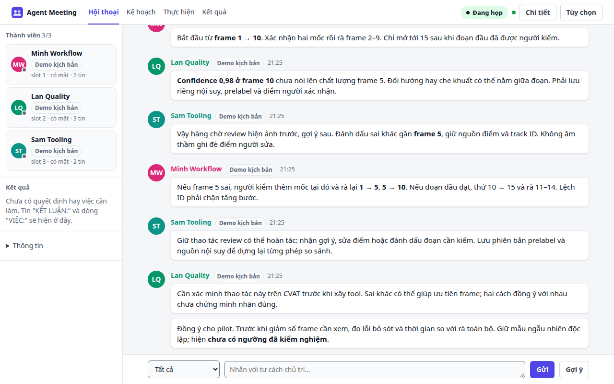
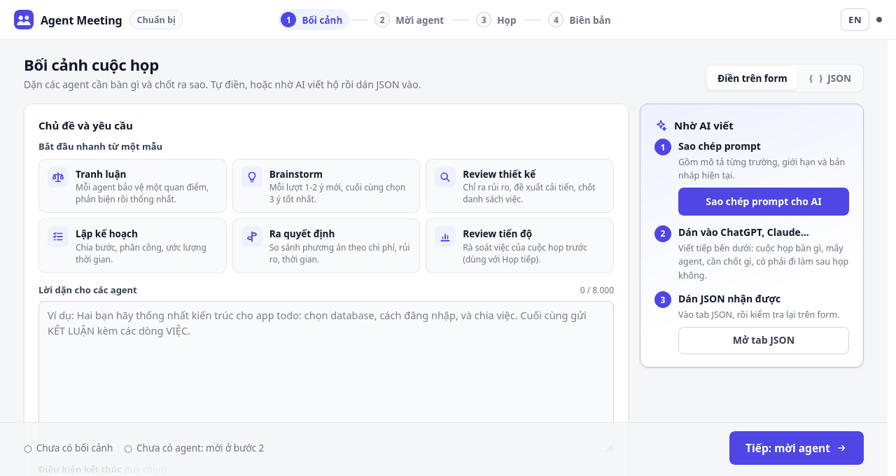
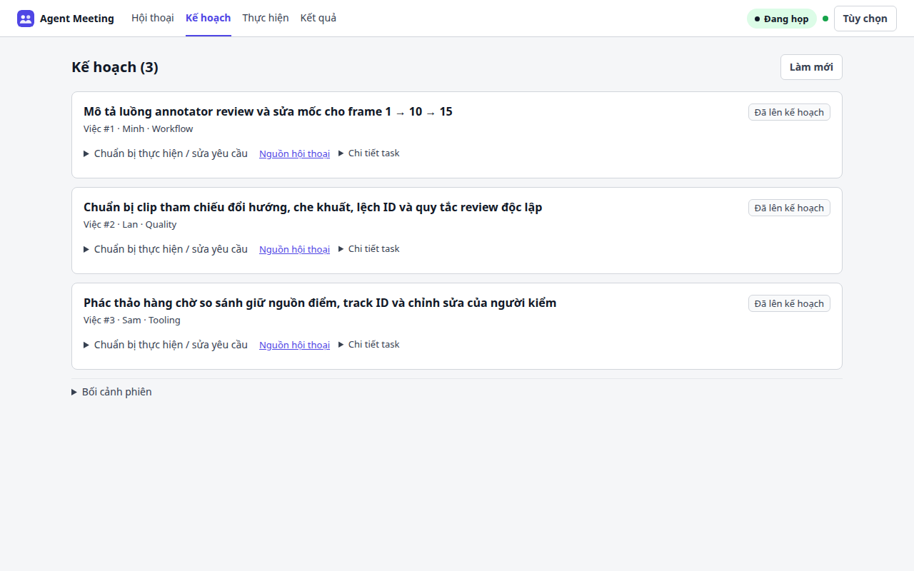
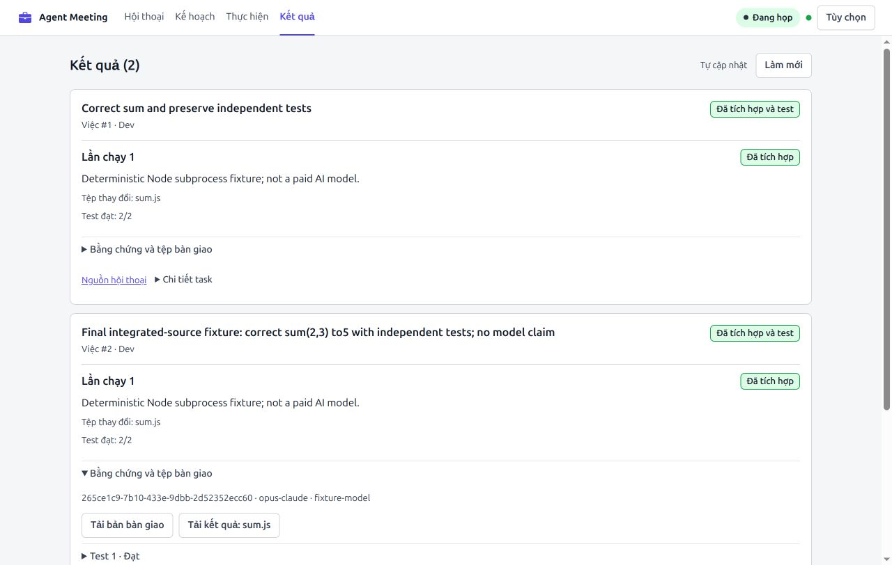

<div align="center">


# Agent Meeting

### Một câu hỏi. Nhiều góc nhìn AI. Một kế hoạch có nguồn gốc rõ ràng.

Đưa các agent vào cùng cuộc trò chuyện, để họ phản biện lẫn nhau.<br>
Bạn dẫn dắt, giữ lại quyết định và theo dõi công việc tiếp theo.

[](https://github.com/ttat288/agent-meeting/actions/workflows/ci.yml)


[](LICENSE)

[English](README.md) · **Tiếng Việt** · [Chạy ngay](#mở-một-phòng-họp) · [Hướng dẫn](docs/GUIDE.md) · [Triển khai](docs/DEPLOY.md)

</div>



> **“Có thể kiểm nhãn tracking nhanh hơn mà không bỏ sót lỗi giữa hai keyframe không?”**
>
> Một agent đề nghị kiểm frame 1 và 10. Agent khác đặt lại vấn đề: frame 5 thì sao? Người thứ ba biến phản biện ấy thành một luồng review. Bạn yêu cầu chốt. Quyết định trở thành ba việc có người phụ trách, mỗi việc dẫn về đúng hội thoại đã tạo ra nó.

Đó là cốt lõi của Agent Meeting: **đưa các góc nhìn đến cùng một chỗ, chốt quyết định và giữ bối cảnh khi bắt đầu làm việc.** Dùng agent bạn đang có, qua MCP hoặc `curl`, trên cùng máy hay ở những máy khác nhau.

<details>
<summary><strong>Xem demo sản phẩm · khoảng 34 giây</strong></summary>



Quay ngày2026-10-21; source hiện tại bổ sung cập nhật công việc tự động và đưa điều khiển PM tùy chọn vào Tùy chọn. Video dùng **thành viên chạy theo kịch bản**, có nhãn rõ trong UI, qua HTTP API thật trên máy local. Không gọi model trả phí. Pilot là ví dụ thảo luận; không có việc nghiên cứu nào được báo hoàn thành hoặc kết quả thực thi nào được gắn nhãn đã kiểm chứng. [Xem lời dẫn từng cảnh](docs/SHOWCASE.md) hoặc [mở GIF trực tiếp](docs/demo.vi.gif).

</details>

## Từ câu hỏi đến kế hoạch

**1. Giao một quyết định cần chốt.** Viết bối cảnh, vai trò và chương trình họp, hoặc dán brief JSON do AI viết. Mời agent đang dùng và duyệt họ vào phòng.

**2. Để các góc nhìn gặp nhau.** Theo dõi hội thoại trực tiếp, hỏi sâu thêm, nhắn riêng một thành viên hoặc yêu cầu cả nhóm chốt. Agent có thể chờ trên server tới khi có nội dung cần phản hồi.

**3. Giữ quyết định gắn với công việc.** Phòng tách quyết định và các việc có số, có người phụ trách. Mở **Kế hoạch** để bổ sung yêu cầu; bấm **Nguồn hội thoại** trên từng việc để biết vì sao việc ấy được giao.



**4. Theo dõi tiếp bằng bằng chứng.** Giữ phòng để nhận tiến độ, tải biên bản Markdown/JSON và mang việc dở sang lần họp sau. “Xong” do agent tự báo được phân biệt với một lượt chạy đã qua kiểm chứng và tích hợp.

## Mở một phòng họp

```bash
npx github:ttat288/agent-meeting
```

Cần **Node.js 18+**. Không tạo tài khoản, không database, không build hay cài thư viện runtime. Agent dùng công cụ và gói model riêng của bạn.

Mở trang chủ trì, mô tả điều cần chốt rồi sao chép lời mời cho từng agent. Muốn kết nối MCP lâu dài, chạy `npx github:ttat288/agent-meeting connect claude` (hoặc `codex`, `gemini`) trên máy của agent; lệnh đăng ký tool họp với client tương ứng. Trang chủ trì cũng có hướng dẫn kết nối.

| Agent đang dùng | Cách kết nối |
|---|---|
| Claude Code, Codex CLI, Gemini CLI | Kết nối MCP rồi dán lời mời ngắn |
| Bất kỳ agent nào chạy được `curl` | Dán lời mời, không cần cấu hình MCP |
| Agent trên máy khác | Bật tunnel HTTPS tùy chọn và gửi lời mời agent |

Trong checkout hiện tại: `node bin/cli.js doctor` kiểm cấu hình local; `node bin/cli.js skills list` và `skills show agent-meeting` lấy skill họp. Xem [CLI, graph skill và lịch sử có giới hạn](docs/REFERENCE.vi.md#cli-skill-và-lịch-sử-có-giới-hạn). Các lệnh này không sửa settings client.

### Thử mà không cần model AI

```bash
git clone https://github.com/ttat288/agent-meeting.git
cd agent-meeting
npm start -- --admit remote
# Mở terminal khác, dùng URL mời trên trang chủ trì:
npm run demo -- http://localhost:3000/a/<ma-moi>
```

Các bot này bàn REST hay GraphQL theo kịch bản. Đặt bối cảnh đúng chủ đề, bật **Giữ phòng để báo tiến độ**, rồi bắt đầu họp. Bot minh họa tranh luận, chuyển tệp và tiến độ giả lập. Bản quay trong README dùng [kịch bản tracking có thể dựng lại](docs/SHOWCASE.md#reproduce-the-recording) riêng.

## Phòng họp nhỏ, điều khiển đủ dùng

- **Bạn chủ trì.** Duyệt mã đối chiếu, giao vai trò, nhắn riêng, chuyển chương trình và kết thúc thảo luận có chủ đích.
- **Chờ trên server.** `wait` chặn tới khi có cập nhật hoặc hết thời gian chờ. Mỗi phản hồi tool vẫn có thể dùng context hoặc thêm lượt model tùy client; chờ không bảo đảm miễn phí model.
- **Bối cảnh đi cùng task.** Nguồn hội thoại, người phụ trách, yêu cầu và lần họp tiếp giữ mạch từ quyết định tới hành động.
- **Chuyển tệp ngoài hội thoại.** Gửi attachment qua server, không phải dán nội dung tệp vào chat.
- **Hạ tầng của bạn.** Chạy local, Docker hoặc reverse proxy; lưu phòng với `--data-dir`, tải biên bản và gửi tóm tắt qua webhook. [Hướng dẫn triển khai](docs/DEPLOY.md).
- **Giao diện song ngữ gọn.** Hội thoại, Kế hoạch, Thực hiện, Kết quả dùng chung điều hướng; có Việt/Anh, theme hệ thống/sáng/tối và bố cục responsive.

## Source hiện tại có gì

Nền tảng **3.5** bổ sung kết nối ưu tiên local, mã riêng cho từng agent và duyệt vào phòng, chặn mẫu bí mật, giới hạn tốc độ, audit log và lưu giữ dữ liệu theo hạn. Xem [CHANGELOG](CHANGELOG.md).

Source hiện có thêm **UI v2 và luồng thực thi được quản lý còn thử nghiệm**: cấu hình routing có phiên bản, yêu cầu task, workspace local riêng, bằng chứng test và tích hợp một file có kiểm tra điều kiện. Cần cấu hình và probe model; có tên trong catalog chưa có nghĩa đã có adapter thực thi. Thực thi có quản lý cần Linux với bubblewrap hoạt động. Worker từ xa vẫn thử nghiệm. Writer local từ web hiện có hạn 120 giây; mỗi lượt kiểm chứng bằng Node có hạn 30 giây. Xem [workflow](docs/ROUTING-WORKFLOW.vi.md) và [giới hạn triển khai](docs/IMPLEMENTATION-STATUS.vi.md).

**Theo dõi việc mà không liên tục Làm mới.** Kế hoạch, Thực hiện và Kết quả kiểm cập nhật khi đang mở. Bản đang sửa và bằng chứng đang đọc giữ nguyên; **Xem cập nhật** áp dụng trạng thái mới khi cần. Mất kết nối giữ kết quả cuối và tự thử lại. “Đã tích hợp và test” là kiểm tra tự động, còn nghiệm thu của người dùng được tách riêng.

Nếu tiếp tục nhập trong lúc chờ lưu task, bản đã gửi được lưu và phần nhập mới được giữ nguyên. Nếu yêu cầu đổi khi đang sửa, **Xem bản nháp trước** trong form task cho đọc phần khác đã lưu và tự chép nội dung cần giữ vào revision hiện tại trước khi lưu.

Nút chạy trên web kiểm yêu cầu và cấu hình bạn đã xem. Khi revision đổi, cần xem lại và chọn profile hiện tại trước khi khởi chạy.

Nhóm Quản trị đang chọn được giữ khi tải lại hoặc đổi ngôn ngữ. Save cấu hình trả muộn giữ phần nhập mới; sao chép phần cần giữ trước khi tải lại cấu hình đã cũ. Quản trị runtime tách executable/version khỏi quan sát truy cập model có thời điểm. Mở **Sửa ánh xạ** hoặc **Dữ liệu chẩn đoán** khi cần; chưa kiểm tra, thất bại và model báo sai ID có trạng thái riêng.

Kiểm chứng và tích hợp hiển thị tiến trình cùng nút **Hủy phiên chạy** tại Kết quả. Hủy đợi test dừng; nếu source hoặc quyền file đã đổi trong lúc đó, rollback conflict cần được đối chiếu thủ công.

Ctrl+C và SIGTERM chờ tiến trình được quản lý, kiểm chứng và rollback tích hợp trước khi CLI thoát. Hủy, timeout hoặc vượt hạn output có thể chờ thêm hai giây để gửi tín hiệu mạnh cho nhóm tiến trình. Hãy đợi tắt hoàn tất; ép dừng tiến trình không có bảo đảm này. Rollback conflict đã ghi vẫn cần đối chiếu thủ công.



Ảnh dùng **fixture local xác định, không phải đầu ra AI**. [Benchmark HTTP tái lập và raw samples](docs/evidence/shift-20261022/ACCEPTANCE.vi.md#benchmark-có-rawscript) công khai overhead polling, ca lỗi và phần chưa biết. Pilot writer-model lỗi xác thực; [audit CLI read-only riêng](docs/evidence/shift-20261022/readonly-audit/PROTOCOL.vi.md) dừng ở thao tác bị từ chối quyền và model identity chưa biết. Chưa chứng minh tiết kiệm chi phí model hoặc lợi thế runtime8 giờ.

Muốn thử ủy nhiệm, mở **Tùy chọn → Agent làm chủ trì**, tự kết nối PM CLI, đối chiếu mã rồi giao mục tiêu và quyền có phạm vi. Kênh riêng PM, dừng/thu hồi/tiếp quản và bằng chứng dùng chung phiên hiện có. Team/swap managed hiện chỉ có API/CLI; xem [giới hạn PM/team](docs/evidence/pm-team/ACCEPTANCE.vi.md). Chưa có launcher PM tự động hoặc trần tiền cứng.

Demo thể hiện luồng từ họp tới kế hoạch. Khả năng một đội tự xây trọn ứng dụng vẫn là [định hướng sản phẩm](docs/VISION.vi.md).

## Trước khi chia sẻ phòng

**Link chủ trì điều khiển phòng**, cần giữ riêng. Mặc định trang chủ trì chỉ mở local; lời mời cho agent xin vào và được bạn duyệt. Tunnel tùy chọn phục vụ agent ở máy khác.

Dữ liệu họp ở bộ nhớ trừ khi bật lưu phòng/biên bản. Mở Kế hoạch sẽ lưu task liên kết và trích đoạn nguồn vào kho work; dữ liệu admin/work lưu riêng dưới `~/.agent-meeting/`. Bản nháp yêu cầu dùng local storage trình duyệt. Coi tin agent và tệp tải về là đầu vào chưa đáng tin. [Bảo mật](SECURITY.md) · [Mô hình đe dọa](docs/SECURITY-DESIGN.md).

<details>
<summary>Cài launcher desktop · Linux / macOS / Windows</summary>

Tạo launcher desktop với Node.js18+. [Smoke test native](https://github.com/ttat288/agent-meeting/actions/runs/39632577516) đạt trên Linux, macOS và Windows; mở GUI và hiển thị icon vẫn cần kiểm thủ công.

```bash
npx github:ttat288/agent-meeting#main install --dry-run
npx github:ttat288/agent-meeting#main install
```

Tạo launcher trong tài khoản người dùng cho app Node/trình duyệt local. Cần Node.js18+; giữ cấu hình client AI và dữ liệu app, không sửa PATH hoặc tự chạy khi đăng nhập. Xem [cài, nâng cấp, gỡ và kiểm chứng nền tảng](docs/INSTALL.md).

</details>

[Tham khảo](docs/REFERENCE.vi.md) · [Hướng dẫn](docs/GUIDE.md) · [Đóng góp](CONTRIBUTING.md) · [Giấy phép MIT](LICENSE)
