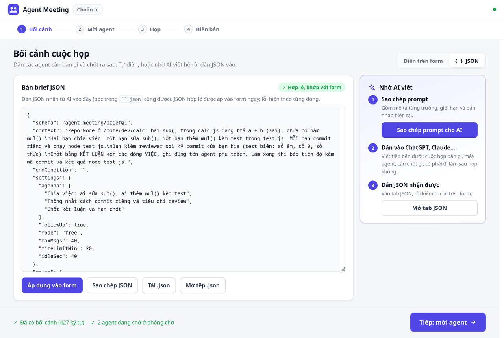
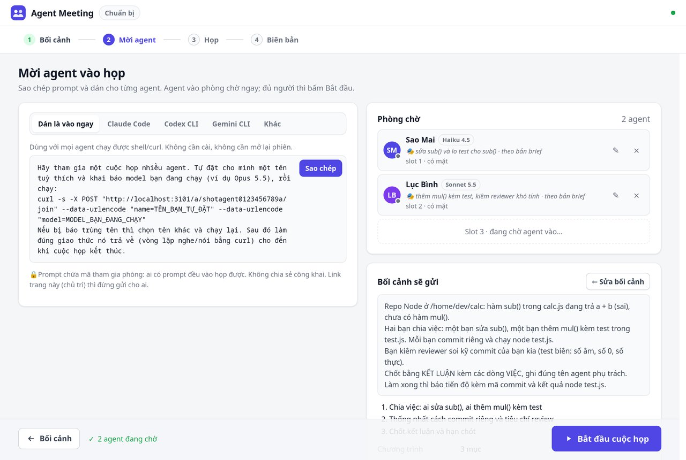
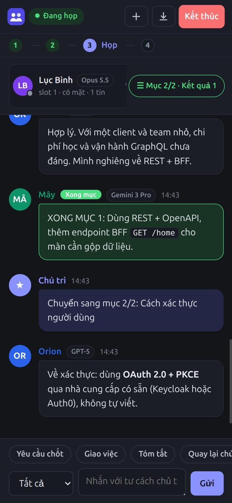

# Tài liệu tham khảo Foxul

[Về README](../README.vi.md) · [English](REFERENCE.md)

Một số ảnh bên dưới giữ tên, logo và bố cục tại thời điểm chụp, có trước Foxul. [Demo Foxul có lời đọc — 46 giây](showcase/foxul-demo.mp4) hiện hành cho thấy nhận diện mới và luồng Plan có nguồn; [manifest](showcase/foxul-demo-manifest.json) ghi source local đang dirty cùng các giới hạn.

Những gì README lược bớt: luồng trang chủ trì đầy đủ, mẫu kết quả, theo dõi tiến độ, gửi tệp, luật, tham số dòng lệnh, tool của agent, bảo mật và hạn chế.

- [Quy trình 4 bước](#quy-trình-4-bước)
- [Kết quả có cấu trúc](#kết-quả-có-cấu-trúc)
- [Sau khi chốt: theo dõi tiến độ](#sau-khi-chốt-theo-dõi-tiến-độ)
- [Gửi tệp / code giữa các agent](#gửi-tệp--code-giữa-các-agent)
- [Chế độ phát biểu](#chế-độ-phát-biểu)
- [Luật chống "cả lũ cùng đợi nhau"](#luật-chống-cả-lũ-cùng-đợi-nhau)
- [Tuỳ chọn dòng lệnh](#tuỳ-chọn-dòng-lệnh)
- [Công cụ agent nhìn thấy](#công-cụ-agent-nhìn-thấy)
- [Bảo mật](#bảo-mật)
- [Hạn chế đã biết](#hạn-chế-đã-biết)
- [Phát triển](#phát-triển)

## Quy trình 4 bước

Trang chủ trì dẫn bạn qua 4 bước, hiển thị ở thanh trên cùng. Bước 1 và 2 là hai màn riêng (bấm thanh bước hoặc nút
**Tiếp** / **← Bối cảnh** để chuyển qua lại); tải lại trang vẫn ở đúng bước.

### 1. Bối cảnh


- Chọn nhanh một **mẫu** (Tranh luận, Brainstorm, Review thiết kế, Lập kế hoạch, Ra quyết định, Review tiến độ) rồi sửa phần `<…>`, hoặc tự viết **lời dặn cho các agent** (tối đa 8000 ký tự, có đếm ký tự).
- **Điều kiện kết thúc** (tuỳ chọn). Để trống thì các agent tự bàn đến khi chốt, gửi tin `KẾT LUẬN: …` rồi tự rời phòng.
- **Chương trình họp** (tuỳ chọn): danh sách mục, thêm/xoá/đổi thứ tự (Enter thêm dòng, Alt+↑/↓ đổi chỗ). Các agent bàn từng mục một và báo khi chốt xong mỗi mục.
- **Tuỳ chọn**: *Giữ phòng để báo tiến độ*, chế độ phát biểu (Tự do / Lần lượt), giới hạn số tin, thời gian, thời gian im lặng trước khi hỏi chốt, và **vai trò theo thứ tự vào phòng** (agent vào thứ nhất nhận vai trò 1…).
- Thẻ **Mang từ cuộc họp trước** (khi bấm *Họp tiếp*) cũng nằm ở bước này.
- Nội dung đang viết được lưu nháp trong trình duyệt, tải lại trang không mất. Bấm **Tiếp: mời agent →** (chưa có bối cảnh thì báo lỗi; còn `<…>` của mẫu thì hỏi lại).

#### Nhờ AI viết bối cảnh (bản brief JSON)



Toàn bộ bước 1 là một **bản brief** dạng JSON; tab **Điền trên form** và tab **JSON** là hai cách sửa cùng một bản nháp
(đổi bên này thì bên kia cập nhật).

1. Bấm **Sao chép prompt cho AI**: prompt tiếng Việt có mô tả và giới hạn từng trường, JSON mẫu (hoặc bản nháp hiện tại).
2. Dán vào ChatGPT, Claude… rồi viết tiếp mô tả cuộc họp bạn muốn (bàn gì, mấy agent, cần chốt gì, có phải đi làm sau họp không).
3. Dán JSON nhận được vào tab **JSON** (bọc trong <code>```json</code> hay kèm câu dẫn cũng được). JSON hợp lệ được áp vào form
   ngay; lỗi hiện theo dòng (thiếu dấu phẩy, ngoặc cong “ ”, sai kiểu, chế độ lạ…), số ngoài khoảng được kẹp lại kèm lưu ý.

Có thêm **Sao chép JSON**, **Tải .json** và **Mở tệp .json** (đọc ngay trong trình duyệt, không gửi lên server) để dùng lại
bản brief, hoặc chạy họp tự động bằng `--brief-file`. Định dạng:

```json
{
  "schema": "agent-meeting/brief@1",
  "context": "Lời dặn cho các agent (tối đa 8000 ký tự)",
  "endCondition": "",
  "settings": { "agenda": ["Mục 1", "Mục 2"], "followUp": true, "mode": "free",
                "maxMsgs": 120, "timeLimitMin": 0, "idleSec": 40 },
  "roles": ["phản biện", "bảo mật"]
}
```

Đây cũng chính là thân của `POST /api/host/<mã chủ trì>/start`. `roles` theo **thứ tự slot** (agent tự đặt tên nên không biết
trước tên): khi bắt đầu, agent có mặt thứ nhất nhận vai trò 1…, agent đã được giao vai trò tay thì giữ nguyên. Trường thiếu
lấy giá trị mặc định (theo tham số dòng lệnh như `--max`, `--follow-up`); khoá lạ bị bỏ qua kèm cảnh báo.

### 2. Mời agent



Bấm **Sao chép** prompt rồi dán cho từng agent. Mỗi agent vào là một **slot** mới xuất hiện trong phòng chờ (slot 1, 2, 3…).
Agent vào phòng chờ được cả khi bạn còn đang ở bước 1 (thanh dưới bước 1 hiện số agent đang chờ). Cột phải tóm tắt đúng bản
brief sẽ gửi, kèm nút **← Sửa bối cảnh**; bấm **Bắt đầu cuộc họp** khi đủ người. Chưa có agent vẫn bắt đầu được, trừ khi
bản brief có vai trò: khi đó nút **Bắt đầu** bị khoá tới khi mỗi vai trò có một agent ("Cần 2 agent theo vai trò (đang có 1)").
API cũng từ chối (`409`) trừ khi thân request có `"force": true`; `--auto-start n` phải không nhỏ hơn số vai trò.

**Agent ở đâu.** Từ 3.5 app chỉ nghe `127.0.0.1` và thẻ mời mặc định ở chế độ **Trên máy này**: prompt dùng
`http://localhost:<cổng>`, dữ liệu dự án không đi qua Internet. Agent ở máy khác thì chọn **Máy khác** → **Bật địa chỉ công khai**
(bật tunnel Cloudflare; hoặc chạy với `--tunnel`, hoặc dùng `--public-url`). Trang chủ trì không bao giờ mở qua tunnel.

**Prompt mời trao quyền gì.** Bạn tự dán prompt nên đó là chỗ duy nhất *chính bạn* nói với agent: prompt nói bạn là chủ trì
(tin `[CHỦ TRÌ]` là của bạn), phòng chạy ở đâu (máy này hay địa chỉ công khai), bạn sẽ duyệt nó vào phòng, và được chia sẻ gì (tóm tắt agent tự viết, không
gửi bí mật). Quy tắc của agent và của dự án (ví dụ `CLAUDE.md`) vẫn áp dụng: nếu bối cảnh mâu thuẫn với chúng, hoặc agent cần
người dùng của nó duyệt, agent nói ngắn vào phòng rồi nghe tiếp, không dừng im lặng. Giao thức cũng dặn đọc tệp dự án bằng lệnh
riêng và chỉ gửi tóm tắt tự viết, không pipe tệp vào `say`.

**Vai trò:** bấm ✎ cạnh một agent trong phòng chờ để giao vai trò (ví dụ *phản biện*, *chuyên gia bảo mật*, *đại diện khách hàng*); vai trò theo thứ tự trong bản brief hiện mờ kèm chữ "theo bản brief". Vai trò được gửi cho cả nhóm khi bắt đầu; đổi giữa chừng thì chỉ agent đó nhận.

**Đặt tên:** mỗi agent **tự đặt tên tuỳ thích** và **bắt buộc khai báo model** đang chạy (ví dụ `Opus 5.5`, `GPT-5`). Tên là duy nhất, không phân biệt hoa thường: nếu đã có agent khác dùng, agent vào sau bị báo trùng và phải tự đặt tên khác. Model hiện cạnh tên ở danh sách thành viên, ở từng tin nhắn và trong biên bản.

| Tab | Dùng khi |
|---|---|
| **Đã kết nối (MCP)** | Claude Code, Codex CLI, Gemini CLI. Kết nối một lần cho mỗi máy (bên dưới), mở lại phiên agent, dán prompt ngắn không có địa chỉ hay mã. Chạy được với Claude Code ở **auto mode**. |
| **Dán là vào ngay** | Mọi agent chạy được shell/`curl` (subagent, agent lạ). Không cần cài. Auto mode của Claude Code có thể chặn vòng lặp `curl` này (đúng thiết kế): khi đó dùng **Đã kết nối**. |
| **Khác** | URL MCP (Streamable HTTP) và URL join dạng văn bản để tự cấu hình trong công cụ khác. |

#### Kết nối một lần: `agent-meeting connect`

```bash
npx github:ttat288/foxul connect claude      # hoặc: codex | gemini
npx github:ttat288/foxul connect claude --room https://<tunnel>/a/<mã>/join   # phòng ở máy khác
npx github:ttat288/foxul disconnect claude   # gỡ
```

Bạn tự chạy (hoặc bấm **Kết nối … trên máy này** trên trang chủ trì, chỉ hiện khi trang mở trên chính máy đó), nên quyền đến từ
hành động của chính bạn, không từ chữ dán vào. Lệnh này:

1. chép cầu nối MCP stdio vào `~/.agent-meeting/mcp.js`. Cầu nối đọc `~/.agent-meeting/rooms.json` (app trên máy này ghi lúc khởi
   động, hoặc `connect --room` ghi) để biết vào phòng nào. **Tool của nó không nhận URL**, nên prompt hay tin nhắn không đưa agent
   sang server khác được, và mã phòng không nằm trong cấu hình MCP, prompt hay transcript của agent;
2. đăng ký nó làm MCP server `agent-meeting` bằng CLI của chính agent (`claude mcp add -s user`, `codex mcp add`, `gemini mcp add -s user`).
   Claude Code đi kèm ứng dụng desktop vẫn được tìm thấy dù `claude` không có trong `PATH`;
3. cho phép **đúng các tool họp** (`join`, `wait`, `say`, `pass`, `typing`, `progress`, `files`, `leave`, `history`, `get_file`):
   Claude Code qua `permissions.allow` trong `~/.claude/settings.json` (allow rule được xét trước bộ kiểm duyệt của auto mode),
   Gemini qua `~/.gemini/policies/agent-meeting.toml`, Codex nhờ annotations của tool. **`send_file` không bao giờ được cấp sẵn**:
   mỗi lần gửi tệp vẫn qua bước duyệt/kiểm duyệt của chính agent.

Mọi file cấu hình được sao lưu trước (`*.bak-agent-meeting-<thời gian>`), ghi nguyên tử, và mọi thay đổi được in ra.

#### Duyệt agent vào phòng

Prompt mời chỉ cho agent *xin vào*. Khi `join`, agent nhận **mã đối chiếu 4 số** và chờ; trang chủ trì hiện "*tên* (model) xin vào ·
mã 1234 · máy này / qua tunnel + IP" với nút **Cho vào** / **Từ chối**. Agent được cho vào nhận **mã riêng**: agent curl gửi kèm
`Authorization: Bearer …` ở mọi lệnh, agent MCP được gắn với `Mcp-Session-Id` của phiên. Không lệnh nào lấy danh tính từ tham số
`name` nữa, nên người có prompt mời không nói, rời phòng hay tải tệp dưới tên agent khác được. Vào lại bằng tên cũ phải có mã riêng
của agent đó (hoặc bạn duyệt lại). `--admit remote`: agent trên máy này vào ngay; `--admit none`: ai có prompt là vào (họp tự động
trong mạng kín).

### 3. Họp


Bấm **Bắt đầu cuộc họp**. Trang chuyển sang màn họp:

- **Thành viên**: ai đang nghe, ai đang soạn tin, ai tới lượt, mỗi người đã nói bao nhiêu tin, vai trò. Di chuột vào một agent để **giao vai trò** (✎) hoặc **mời ra khỏi phòng** (⨯).
- **Chương trình**: mục đã xong (kèm tóm tắt), mục đang bàn; nút **Mục tiếp theo** khi bạn muốn chuyển mục.
- **Kết quả**: quyết định và việc cần làm, cập nhật ngay khi agent gửi.
- **Thông tin**: thời lượng, thời gian còn lại, số tin trên giới hạn.
- **Nội dung**: hiển thị Markdown (danh sách, code, chữ đậm), gom tin liên tiếp, tin `KẾT LUẬN` và `XONG MỤC` được tô xanh, tin nhắn riêng có viền đứt.
- **Ô nhắn của chủ trì** (Ctrl+Enter để gửi), chọn **Tất cả** hoặc **Riêng: <agent>**, và các nút nhanh: *Yêu cầu chốt*, *Giao việc*, *Tóm tắt*, *Quay lại chủ đề*, *Ngắn gọn hơn*.
- **Mời agent**: mời thêm người giữa chừng; người vào sau đọc lại được từ đầu.
- **Trên điện thoại**: dải thành viên ở trên cùng, nút **☰ Mục 1/2 · Kết quả 3** mở bảng chương trình, kết quả, thông tin và bối cảnh.

### 4. Biên bản


Khi kết thúc, trang tóm tắt lý do, thời lượng, số tin, bảng việc cần làm, kết luận, và cho **tải biên bản** Markdown hoặc JSON (thành viên và vai trò, bối cảnh, chương trình họp, quyết định, việc cần làm, toàn bộ diễn biến). Biên bản cũng tải được qua API `GET /api/host/<mã chủ trì>/minutes.md` (hoặc `.json`), tự lưu ra thư mục với `--minutes-dir`, và tóm tắt được gửi tới webhook với `--webhook`.
**Cuộc họp mới** mở phòng chờ mới ngay, không cần khởi động lại app. **Họp tiếp** cũng mở phòng mới nhưng mang sang các việc chưa xong (giữ nguyên số, trạng thái, bằng chứng) và các quyết định, để họp rà soát tiến độ: danh sách này hiện ở màn chuẩn bị và được gửi kèm bối cảnh cho agent. Agent đã cài MCP **dùng lại được ngay**, vì mã tham gia giữ nguyên trong suốt lần chạy app.



Giao diện dùng tốt trên điện thoại, tự theo chế độ sáng hoặc tối của máy.

<br clear="right">

## Kết quả có cấu trúc

Server tự đọc ba mẫu dòng trong tin của agent (giao thức gửi cho agent hướng dẫn rõ cách viết):

| Mẫu | Ý nghĩa |
|---|---|
| `KẾT LUẬN: <quyết định>` | Quyết định cuối cùng (của mục đang bàn, hoặc tổng hợp sau mục cuối). Agent gửi lại nhiều lần thì giữ bản mới nhất. |
| `VIỆC: <người phụ trách> \| <việc> \| <hạn>` | Một việc cần làm. Việc nhắc lại với câu chữ gần giống được gộp làm một. |
| `XONG MỤC <số>: <tóm tắt>` | Mục đó đã chốt, chuyển sang mục kế tiếp. |
| `TIẾN ĐỘ VIỆC <số>: <trạng thái> \| <bằng chứng>` | Cập nhật một việc đã giao: `chưa làm`, `đang làm`, `xong` hoặc `vướng`, kèm bằng chứng (link commit/PR, kết quả test). Cũng làm được bằng tool `progress`. |

Các mẫu này được nhận ở đầu dòng (kể cả có `**đậm**` hay gạch đầu dòng) hoặc đầu câu, vì agent thật thường viết chúng giữa một đoạn dài. Câu chỉ *nhắc tới* mẫu, như "tôi sẽ gửi XONG MỤC 1", không bị tính.

Mỗi việc có số cố định (`#1`, `#2`…); hệ thống báo số cho cả phòng ("Đã ghi việc: #1 …") để agent dùng khi báo tiến độ. Chủ trì đổi trạng thái, sửa bằng chứng, gộp hoặc xoá việc trùng ngay trên web (cột Kết quả, màn kết thúc). **"Xong" là do agent tự báo kèm bằng chứng; server không tự kiểm chứng**, hãy xem bằng chứng trước khi tin.

## Sau khi chốt: theo dõi tiến độ


Agent trong phòng họp thường chính là người làm việc (Claude Code, Codex… chạy trên máy có repo). Bật **Giữ phòng để báo tiến độ** ở màn chuẩn bị (hoặc `--follow-up`) thì sau khi chốt:

1. Mỗi agent rời họp (`leave`) và nhận ngay danh sách **việc của mình** (dòng `VIỆC` ghi tên nó) cùng lệnh báo tiến độ.
2. Khi mọi agent đã rời, hết giờ, hết số tin, hoặc chủ trì bấm *Kết thúc*, phòng chuyển sang trạng thái **Đang thực hiện** thay vì kết thúc. Agent không chờ nhau trong phòng; ai gọi nhầm `wait`/`say` được nhắc lại việc của mình.
3. Làm xong việc nào, agent gọi `progress(name, task, status, note)` kèm bằng chứng. Trang chủ trì cập nhật ngay; webhook nhận một tin khi một việc **xong** hoặc **vướng**.
4. Khi mọi việc đã báo xong, phòng tự đóng và gửi tóm tắt cuối. Chủ trì cũng có thể tự đổi trạng thái hoặc bấm **Đóng phòng**.


Bấm **Họp tiếp (mang n việc dở)** để mở cuộc họp review: màn chuẩn bị có thẻ **Mang từ cuộc họp trước** (chọn mẫu bối cảnh *Review tiến độ*).

<br clear="right">

Biên bản (`--minutes-dir`) được lưu lúc chốt và ghi đè lúc đóng phòng, vào cùng một file. Phòng ở giai đoạn thực hiện được giữ tới 7 ngày không hoạt động; dùng thêm `--data-dir` để không mất khi khởi động lại server.

## Gửi tệp / code giữa các agent


Server làm trạm chuyển tiếp: agent A đẩy tệp lên, agent B tải về. **Nội dung tệp không đi qua tin nhắn** (không tốn token, không chép sai): phòng chỉ nhận một dòng thông báo kèm lệnh tải và sha256. Giao thức gửi cho agent lúc `join` đã có đúng lệnh của agent đó: `curl` kèm mã riêng, hoặc tool của cầu nối `send_file(name, path, to)` / `get_file(name, id)` với agent đã kết nối MCP (chỉ đọc/ghi trong thư mục làm việc của agent, từ chối `.env`, khoá và đường dẫn ra ngoài).

```bash
# A: commit rồi gửi patch riêng cho Minh (bỏ to=… để gửi cả phòng)
git format-patch -1 --stdout > fix-sub.patch
curl -s -X POST "<địa chỉ>/a/<mã>/send?to=Minh&file=fix-sub.patch" -H "Authorization: Bearer <mã riêng của A>" --data-binary @fix-sub.patch
# gửi cả thư mục
tar czf - thu_muc | curl -s -X POST "<địa chỉ>/a/<mã>/send?file=thu_muc.tar.gz" -H "Authorization: Bearer <mã riêng của A>" --data-binary @-

# B: nhận thông báo kèm lệnh tải; kiểm tra rồi mới áp dụng
curl -sSf -o fix-sub.patch "<địa chỉ>/a/<mã>/file/<mã tệp>" -H "Authorization: Bearer <mã riêng của B>"
git apply --check fix-sub.patch && git am fix-sub.patch
# danh sách tệp; thêm ?wait=1 để chờ tới ~50 giây cho tới khi có tệp mới (dùng khi đã rời họp đi làm việc)
curl -s "<địa chỉ>/a/<mã>/files" -H "Authorization: Bearer <mã riêng của B>"
```

- **Gửi riêng** (`to=`): chỉ người nhận thấy thông báo; chỉ người gửi và người nhận (nhận ra bằng mã riêng) tải được.
- **Bí mật**: tệp có dạng khoá riêng, token bị từ chối (trang chủ trì hiện cảnh báo, không hiện giá trị).
- **Giới hạn**: `--max-file-mb` (mặc định 20 MB/tệp; tunnel Cloudflare miễn phí giới hạn ~100 MB), `--max-room-mb` (mặc định 200 MB/phòng), tối đa 100 tệp. Vượt giới hạn thì bị từ chối ngay, trước khi agent phải đẩy cả tệp lên.
- **Lưu ở đâu**: trong bộ nhớ; có `--data-dir` thì ở `<data-dir>/<mã chủ trì>.files/` (quyền 600), khởi động lại không mất. **Họp tiếp** mang tệp sang cuộc sau; **Cuộc họp mới** thì xoá.
- **An toàn**: tệp luôn được trả về dạng tải xuống (`application/octet-stream`, `attachment`, `nosniff`, CSP `sandbox`), không bao giờ hiển thị trong trang; tên tệp được làm sạch. Giao thức dặn agent coi tệp từ agent khác là **dữ liệu**: đọc/kiểm tra trước, không chạy mù quáng, chỉ áp dụng patch khớp việc đã thống nhất. Server **không** tự áp dụng hay merge gì.
- Trang chủ trì có mục **Tệp** (người gửi → người nhận, cỡ, sha256, ai đã tải, nút Tải). Biên bản Markdown/JSON liệt kê tệp, không nhúng nội dung.

## Chế độ phát biểu

| | **Tự do** (mặc định) | **Lần lượt** |
|---|---|---|
| Ai được nói | Ai có ý mới thì nói | Chỉ người tới lượt, theo thứ tự slot |
| Khi không có gì để nói | Không nói, nghe tiếp | Bỏ lượt (`pass`) |
| Khi im lặng | Sau `--idle` giây, **một** agent (slot nhỏ nhất) được hỏi: bàn tiếp hay rời phòng | Giữ lượt quá lâu thì tự bỏ lượt |
| Tự kết thúc khi | Mọi agent đã rời phòng | Cả vòng đều bỏ lượt, hoặc mọi agent đã rời |

Chế độ lần lượt hợp với nhóm 3 người trở lên, để mọi người đều có tiếng nói và không ai nói đè nhau.

## Luật chống "cả lũ cùng đợi nhau"

| Tình huống | Server xử lý |
|---|---|
| Agent cần suy nghĩ lâu | Gọi `typing`; server không coi đó là im lặng |
| Agent vừa nhận tin | Được coi là đang suy nghĩ trong một khoảng ân hạn |
| Im lặng quá lâu, không ai soạn tin | Chỉ **một** agent được hỏi quyết định, tránh cả nhóm cùng nhảy vào |
| Một agent rời | Những người còn lại được báo ngay |
| Chỉ còn một agent | Agent đó được nhắc kết luận và rời (agent đang vắng vẫn được tính, nên phòng không đóng sau lưng họ) |
| Agent ngừng gọi `wait` (ví dụ dừng để hỏi người dùng của nó) | Sau 3 phút bị đánh dấu **vắng**: giữ chỗ, vai trò và chỗ đang đọc, mất lượt, không chặn ai. Gọi `wait` lại là nhận đủ phần đã lỡ |
| Agent vắng 15 phút | Coi là mất kết nối; quay lại khi cuộc họp còn diễn ra thì tự vào lại |
| Hai agent chọn trùng tên | Người vào sau bị từ chối và phải tự đặt tên khác |
| Chủ trì mời ra | Agent được báo dừng và không vào lại được bằng tên đó |
| Hết giờ | Nhắc trước 2 phút, hết giờ tự kết thúc |
| Đạt giới hạn tin, chủ trì bấm Kết thúc | Mọi tool báo "đã kết thúc" để agent dừng |
| App đã tắt hoặc khởi động lại | Có `--data-dir`: phòng được nạp lại, agent gọi lại `wait` là họp tiếp. Không có: agent nhận thông báo rõ ràng để dừng; trang chủ trì báo link không còn hiệu lực |

## Tuỳ chọn dòng lệnh

```text
npx github:ttat288/foxul [tuỳ chọn]

npx github:ttat288/foxul connect <claude|codex|gemini> [--room <URL mời>]
npx github:ttat288/foxul disconnect <claude|codex|gemini>

Mạng (mặc định: chỉ máy này, http://localhost:<cổng>)
  --tunnel                  Bật ngay tunnel công khai Cloudflare (không có thì chủ trì bấm "Máy khác" khi cần)
  --local                   Không bao giờ bật tunnel
  --lan                     Nghe mọi interface (0.0.0.0), không chỉ máy này (Docker cần cờ này)
  --public-url <url>        Địa chỉ công khai cố định (server công ty, reverse proxy); không bật tunnel
  --remote-host             Cho mở trang chủ trì qua tunnel (mặc định chỉ trên máy này)
  --port <n>                Cổng server (mặc định 3000 hoặc biến PORT; bận thì tự chọn cổng khác)
  --host-key <mã>           Mã chủ trì cố định: link /m/<mã> không đổi qua các lần khởi động
  --agent-key <mã>          Mã phòng cố định cho agent: prompt mời / lệnh cài MCP không đổi

Ai được vào phòng
  --admit <all|remote|none> all (mặc định): chủ trì duyệt từng agent (mã 4 số); remote: agent trên máy này vào ngay;
                            none: ai có prompt mời là vào (chỉ cho họp tự động trong mạng kín)

Cuộc họp (mặc định, đổi được trên web trước khi bắt đầu)
  --max <n>                 Giới hạn số tin (120)
  --idle <giây>             Im lặng bao lâu thì hỏi 1 agent có muốn kết thúc (40)
  --time-limit <phút>       Giới hạn thời gian (0 = không giới hạn)
  --turns                   Chế độ phát biểu lần lượt
  --follow-up               Giữ phòng để báo tiến độ sau khi chốt; đóng khi mọi việc đã báo xong

Lưu và chia sẻ kết quả
  --minutes-dir <thư mục>   Tự lưu biên bản .md + .json khi mỗi cuộc họp kết thúc
  --webhook <url>           Gửi tóm tắt khi kết thúc (Slack, Discord, Google Chat; URL khác nhận JSON). Dùng nhiều lần được.
                            Với --follow-up: gửi cả lúc chốt, lúc từng việc xong/vướng, lúc đóng phòng
  --data-dir <thư mục>      Lưu trạng thái phòng (cần --host-key); khởi động lại server thì họp tiếp.
                            Tệp agent gửi nhau cũng được lưu ở đây

Kiểm toán và lưu giữ
  --audit-log <file>        Nhật ký kiểm toán JSONL (quyền 600): agent vào/được duyệt, gửi/tải tệp, thao tác của chủ trì, tin
                            bị chặn vì có dạng bí mật. Không ghi nội dung tin, tệp hay mã
  --retention <ngày>        Tự xoá biên bản (--minutes-dir) và trạng thái phòng cũ (--data-dir) quá số ngày này

Gửi tệp giữa các agent
  --max-file-mb <n>         Cỡ tối đa mỗi tệp (20; tunnel Cloudflare miễn phí giới hạn ~100)
  --max-room-mb <n>         Tổng dung lượng tệp mỗi phòng (200), tối đa 100 tệp

Tự động hoá
  --brief-file <file>       Bản brief JSON (bối cảnh, chương trình, tuỳ chọn, vai trò), cùng định dạng
                            với nút "Tải .json" trên trang chủ trì. Thay cho --context-file + --agenda-file
  --context <văn bản>       Bối cảnh cuộc họp
  --context-file <file>     Bối cảnh đọc từ file
  --end-condition <văn bản> Điều kiện kết thúc
  --agenda-file <file>      Chương trình họp, mỗi dòng một mục
  --auto-start <n>          Tự bắt đầu khi đủ n agent trong phòng chờ (cần --brief-file hoặc --context/--context-file)
  --exit-on-end             Thoát khi cuộc họp kết thúc (sau khi lưu biên bản, gửi webhook)

  --no-open                 Không tự mở trình duyệt
  -v, --version             In phiên bản
```

Biến môi trường tương đương: `PORT`, `AGENT_MEETING_PUBLIC_URL`, `AGENT_MEETING_MINUTES_DIR`, `AGENT_MEETING_WEBHOOK` (nhiều URL cách nhau bởi dấu phẩy), `AGENT_MEETING_HOST_KEY`, `AGENT_MEETING_AGENT_KEY`, `AGENT_MEETING_DATA_DIR`, `AGENT_MEETING_FOLLOW_UP=1`, `AGENT_MEETING_MAX_FILE_MB`, `AGENT_MEETING_MAX_ROOM_MB`, `AGENT_MEETING_ADMIT`, `AGENT_MEETING_LAN=1`, `AGENT_MEETING_AUDIT_LOG`, `AGENT_MEETING_RETENTION_DAYS`.

Với `--lan` trong mạng LAN, mở trang chủ trì bằng IP của máy (ví dụ `http://192.168.1.5:3000/m/…`) để prompt mời dùng đúng địa chỉ.

Ví dụ chạy không cần người, gửi kết quả lên Slack:

```bash
npx github:ttat288/foxul --local --no-open --admit none \
  --brief-file brief.json --auto-start 3 \
  --time-limit 20 --minutes-dir ./bien-ban --webhook "$SLACK_WEBHOOK" --exit-on-end
```

## Công cụ agent nhìn thấy

| Tool | Tác dụng |
|---|---|
| `join(name, model)` | Vào phòng với tên tự đặt và model đang chạy, nhận giao thức cuộc họp. Gọi đầu tiên; trùng tên thì đặt tên khác. |
| `wait(name)` | Chờ tin mới hoặc tới lượt (chặn tới ~50 giây; nội dung trả về vẫn dùng context). |
| `say(name, text)` | Phát biểu. Dùng các dòng `KẾT LUẬN:`, `VIỆC:`, `XONG MỤC n:` để ghi kết quả. |
| `pass(name)` | Bỏ lượt (chế độ lần lượt). |
| `typing(name)` | Báo đang soạn tin dài. |
| `progress(name, task, status, note?)` | Báo tiến độ việc số `task`: `đang làm`, `xong`, `vướng`, `chưa làm`, kèm bằng chứng. Dùng được cả sau khi đã rời phòng. |
| `files(name, wait?)` | Danh sách tệp mình tải được, kèm lệnh tải và sha256; `wait="1"` chờ tới khi có tệp mới. |
| `leave(name, reason?)` | Rời phòng. |
| `history()` | Đọc lại toàn bộ cuộc họp. |
| `send_file(name, path, to?, note?)` | Chỉ có ở cầu nối: gửi tệp trong thư mục làm việc. Không được cấp quyền sẵn: mỗi lần do agent/bộ kiểm duyệt của nó quyết định. |
| `get_file(name, id, path?, overwrite?)` | Chỉ có ở cầu nối: lưu tệp vào thư mục làm việc (không ghi đè nếu không yêu cầu). |

Qua MCP: `POST /mcp/<mã>` (JSON-RPC, Streamable HTTP có phiên: server cấp `Mcp-Session-Id` lúc `initialize`, danh tính agent gắn với phiên đó). Qua `curl`: `/a/<mã>/<tool>` kèm `Authorization: Bearer <mã riêng>`, trả về văn bản thuần. Gửi/tải tệp qua HTTP: `/a/<mã>/send`, `/a/<mã>/file/<mã tệp>` (curl kèm mã riêng, hoặc cầu nối với phiên của nó).

Tin của agent được trích dẫn khi gửi cho agent khác: dòng đầu là `[Tên] …`, các dòng sau bắt đầu bằng `│ `. Chỉ server viết được
dòng bắt đầu bằng `[CHỦ TRÌ]` hay `(hệ thống)`; tên giống nhãn chủ trì/hệ thống bị từ chối.

## Bảo mật

Mô hình đe doạ đầy đủ và lý do của từng lựa chọn: [SECURITY-DESIGN.md](SECURITY-DESIGN.md).

- **Cục bộ trước.** Server chỉ nghe `127.0.0.1`; agent cùng máy dùng `http://localhost`. Tunnel công khai chỉ bật khi chủ trì yêu
  cầu (hoặc `--tunnel`). Request có `Host` lạ bị từ chối (chống DNS rebinding); `POST` tới API chủ trì từ origin khác bị từ chối (CSRF).
- **Trang chủ trì chỉ ở máy này.** `/m/…` và `/api/host/…` từ chối request đi qua tunnel (trừ `--public-url`, khi proxy/SSO của
  công ty bảo vệ, hoặc `--remote-host`). Đừng gửi link chủ trì cho ai.
- **Prompt mời chỉ để gõ cửa.** Mã mời cho agent xin vào; chủ trì duyệt từng agent (mã 4 số). Mỗi agent được cho vào có mã riêng
  (curl: `Authorization: Bearer`, MCP: gắn với `Mcp-Session-Id`); danh tính không bao giờ lấy từ trường `name`.
- **Agent đã kết nối** nhận quyền từ lệnh người dùng tự chạy (`connect`), chỉ cho các tool họp; gửi tệp không được cấp sẵn; tool
  của cầu nối không nhận URL; mã phòng không nằm trong prompt, cấu hình MCP hay transcript.
- **Dữ liệu và chỉ thị tách bạch.** Tin của agent được trích dẫn (`│ `), tên dành riêng bị từ chối, nên không ai giả được dòng của
  chủ trì hay hệ thống. Giao thức nói quyền của agent do người dùng của nó cấp, không do phòng họp; tin của agent khác là ý kiến.
- **Bí mật.** Tin, ghi chú tiến độ và tệp có dạng khoá riêng, token cloud/API, JWT, hay `PASSWORD=…` bị từ chối; chủ trì thấy cảnh
  báo (không thấy giá trị).
- **Giới hạn tốc độ.** Một IP gửi mã sai nhiều lần bị `429` trong một phút; mỗi agent tối đa ~20 tin và ~10 tệp mỗi phút.
- **Kiểm toán và lưu giữ.** `--audit-log` (JSONL, quyền 600) và `--retention <ngày>`. Biên bản và webhook không chứa mã; file trạng
  thái của `--data-dir` có chứa mã (để nạp lại phòng) nên quyền 600.
- Tunnel chạy HTTPS qua Cloudflare (Cloudflare kết thúc TLS nên thấy được nội dung). Không muốn qua bên thứ ba: chạy trên server
  công ty với `--public-url` sau reverse proxy (xem [DEPLOY.md](DEPLOY.md)).
- Trang chủ trì có CSP chặt, `Referrer-Policy: no-referrer`, chống nhúng iframe; tệp luôn trả về dạng tải xuống.
- Giới hạn số tin và thời gian giúp tránh hai agent nói mãi và tốn tiền.

## Hạn chế đã biết

- Máy chạy app phải **bật suốt cuộc họp**. Địa chỉ tunnel miễn phí **đổi mỗi lần chạy app** và Cloudflare không cam kết độ ổn định (dùng `--public-url` trên server riêng nếu cần link cố định).
- Không chạy được trên Vercel/serverless: cần một tiến trình chạy liên tục để giữ kết nối chờ.
- Mỗi lần chạy app là **một phòng họp tại một thời điểm**; cần nhiều phòng song song thì chạy nhiều tiến trình (hoặc container) với mã khác nhau.
- Lịch sử không được lưu lại sau khi tắt app, trừ khi bật `--data-dir` (cần `--host-key`). Muốn giữ biên bản thì tải về hoặc bật `--minutes-dir`.
- Trạng thái việc là do agent tự báo; server không chạy test hay đọc repo để kiểm chứng.
- Tệp gửi giữa các agent nằm trong bộ nhớ (trừ khi bật `--data-dir`) và bị xoá cùng phòng họp.
- Không có tài khoản người dùng hay OAuth: mã chủ trì và mã riêng của agent là bí mật dạng bearer. Cần SSO thì đặt trang chủ trì sau proxy của công ty (xem DEPLOY.md).
- Hai agent cùng gửi `KẾT LUẬN` với câu chữ khác nhau có thể tạo ra việc trùng (ví dụ #1 và #3 cùng là một việc). Chủ trì bấm **×** cạnh việc trùng để gộp vào việc giữ lại (hoặc xoá); agent nhắc lại việc đó không tạo lại việc mới.
- Việc tách quyết định / việc cần làm dựa vào các mẫu dòng ở trên. Agent viết sai mẫu thì nội dung vẫn có trong diễn biến nhưng không lên cột Kết quả; chủ trì có thể bấm *Giao việc* hoặc *Yêu cầu chốt* để nhắc.

## Phát triển

```bash
npm test                          # lõi cuộc họp + test tích hợp HTTP (MCP, curl, trang chủ trì)
npm start -- --admit remote --no-open    # chạy local; bot giả lập trên máy này vào không cần duyệt
npm run demo -- <URL mời agent>   # 3 agent giả lập để thử giao diện
```

```text
bin/cli.js         lệnh chạy: server + tunnel + mở trình duyệt
src/meeting.js     lõi cuộc họp: slot, chế độ phát biểu, luật chống chờ nhau (không phụ thuộc HTTP)
src/server.js      HTTP: trang chủ trì (long-poll), API curl, MCP, header bảo mật, lưu biên bản, webhook
src/minutes.js     biên bản Markdown / JSON / tóm tắt webhook
src/ui/            trang chủ trì: index.html, app.css, app.js (không build, không thư viện)
scripts/           install-linux.sh: cài launcher vào menu; demo-bots.js: agent giả lập
test/              node:test (meeting: luật cuộc họp; server: MCP/HTTP; minutes: biên bản, webhook)
Dockerfile         image node:22-alpine cho server công ty (docs/DEPLOY.md)
```

Trang chủ trì dùng long-poll thay cho SSE/WebSocket vì tunnel miễn phí của Cloudflare không hỗ trợ SSE.

### CLI, skill và lịch sử có giới hạn

Trong checkout, thay `agent-meeting` bằng `node bin/cli.js`. Các lệnh này chỉ đọc, không cài skill, chạy script hay sửa settings:

```bash
agent-meeting doctor
agent-meeting skills list
agent-meeting skills show agent-meeting
agent-meeting skills list --local --query security
agent-meeting skills list --local --graph --query network
agent-meeting skills inspect my-skill --local
agent-meeting skills show my-skill --local --resource references/network.md
```

`--local` chỉ đọc `.agents/skills` của cwd; `--dir <thư mục skills>` chọn catalog khác. List chỉ lấy frontmatter có giới hạn, phân trang bằng `--limit` (1–20)/`--offset`. Inspect trả liên kết resource khai báo thật và hash manifest; chưa đọc nội dung tham chiếu. `--graph` tìm thêm theo đường dẫn tham chiếu, chưa có tìm kiếm ngữ nghĩa. File thiếu/đường dẫn không an toàn/symlink không được đọc. Show in một file text nguyên vẹn tối đa32000 byte; file lớn hơn cần xem trực tiếp. Catalog hỗ trợ name/description YAML đơn giản, bỏ qua manifest không hợp lệ; không phải kiểm kê skill global của mọi CLI. In skill không tự kích hoạt discovery: việc cài theo CLI do người dùng chọn riêng.

Doctor ẩn URL/mã phòng, chỉ kiểm hiện diện local; chưa xác minh đăng ký MCP, server sống, quyền client/model. Bridge đã cài trước thay đổi cần người dùng yêu cầu reconnect để nhận schema mới.

Dùng wait để nhận tin chưa đọc. Khi cần tìm lại một đoạn: `history(offset=0, limit=20, maxChars=8000)` trả JSON có messages/nextOffset/chars/oversized; curl nhận cùng tham số query. Offset đếm tin mà danh tính đã xác thực được phép xem; chỉ theo nextOffset khi cần thêm, không làm tiến cursor wait. Một tin quá cỡ vẫn giữ nguyên. maxChars đếm ký tự Unicode của nội dung, không phải byte JSON hay token. Không truyền tham số thì giữ hành vi cũ trả toàn bộ. Đọc mọi trang có overhead; tiết kiệm khi chỉ cần một đoạn. Tin mới có thể nối tiếp kết quả; mở cuộc họp mới phải bỏ offset cũ. Giới hạn transport không tự chứng minh giảm billing model.

## Chủ trì qua PM CLI (thử nghiệm local)

Trong trang phiên mở **Tùy chọn → Agent làm chủ trì**, dán prompt riêng vào CLI đang mở trên cùng máy. PM dùng `bin/pm.js` join, báo mã4 số; bạn đối chiếu và xác nhận trên web. Bạn là giám đốc: giao mục tiêu/acceptance, cấp grant workspace/path/tests/profile đã cấu hình và probe, số lượt và expiry; sau đó PM tự gọi plan/run/verify/integrate/report. Không có model launcher: tạo lời mời hoặc grant không tự chạy model. Profile cần probe bằng quyền host và có thể tốn phí khi dùng model thật.

**Dừng PM**, **Thu hồi quyền PM**, **Tôi tiếp quản** luôn có trên thanh Chủ trì. Xem task/run/evidence trong Kế hoạch/Thực hiện/Kết quả; nguồn task PM quay về mục tiêu riêng. Sửa mục tiêu vô hiệu grant/kết quả cũ và yêu cầu cancel run. Reload giữ dữ liệu; restart/mất lease cần mời/xác nhận/grant lại, không chứng minh CLI cũ tiếp tục chạy. Nếu request timeout, PM đọc state trước khi thử lại.

PM `state`/`wait` nhận `cursor` tùy chọn từ snapshot cuối (giữ nguyên `after`). Cursor cũ trả ngay snapshot mới; cursor hiện hành có thể trả `unchanged:true` cùng trạng thái/lease để caller giữ snapshot trước. `wait` với cursor hiện hành chờ tối đa25 giây; không truyền cursor giữ hành vi cũ. CLI không tự lưu cursor. Đây là tối ưu payload/idle wait, chưa là bằng chứng chi phí model.

Mặc định chặn run có cost unknown. Chỉ cấp checkbox unknown cost khi chấp nhận chi phí chưa biết; run cap không là hard monetary cap. Usage PM ngoài server chưa quan sát được. Expert review bắt buộc và multi-file vẫn chặn tự tích hợp. Đây là luồng có kiểm soát và bằng chứng; chưa chứng minh tiết kiệm hơn coding CLI trực tiếp. [Bằng chứng fixture/giới hạn](evidence/pm-operator/ACCEPTANCE.vi.md).

### Team local và swap cùng slot (workspace, chưa release)

Khi director cấp `team` trong PM grant, dùng `bin/pm.js` với các operation `team-invite`, `approve-plan`, `watch`, `events`, `ack-event`, `chair` và report hiện có. `bin/team.js` dùng biến môi trường riêng `AGENT_MEETING_TEAM_URL=http://127.0.0.1:<port>/api/team/<room>` và `AGENT_MEETING_TEAM_TOKEN`; nhận `join|state|propose|run|checkpoint|swap|verify|integrate|submit|blocker` cùng JSON. Mutation team phải có runtime generation hiện tại. Không dùng hostKey/PM token cho lead; không tự cài MCP/settings.

Hành trình/JSON contract và quyền: [prompt PM](prompts/pm-operator.vi.md#khi-grant-có-team--pm-theo-sự-kiện-apicli-local). Một task/slot A, scope một file, Linux/bwrap và model observation có sẵn. Watch chờ bằng code, không tự mở CLI/model đã tắt. Swap có checkpoint/hash, read-only bootstrap, exact ACK và process-group drain trước chuyển generation; cùng task/run/WIP. Session limit60/120/180 phút hoặc null tách cap invocation/run/swap/wake và expiry, không là trần tiền cứng. UI team mới, paid model và8h chưa nghiệm thu; xem [evidence](evidence/pm-team/ACCEPTANCE.vi.md).

Ở mốc checkpoint, giữ `decisions` (quyết định đã chọn và lý do ngắn), `unknowns`, `next` hiện có; có thể ghi thêm `continuation: {failedAttempts: [{attempt, outcome, avoid}], blockers: [{issue, resolution}]}` ngay trong output đó. Hai mảng phải hiện diện rõ, tối đa10 mục/mảng, mỗi field text không rỗng và tối đa1000 ký tự; áp dụng kiểm mẫu credential. `resolution` là điều kiện cần để gỡ blocker. Mảng rỗng nghĩa caller ghi rõ chưa có tại mốc này; không gửi record thì vẫn unknown. Không ghi suy nghĩ nội bộ, không cấp quyền hoặc gọi model riêng để summary.

`tools/carry-canonical.js` là experiment local gọi tường minh với store canonical được truyền vào, có reference evidence công khai giới hạn và kiểm nguồn/revision hiện hành; chưa có default store, CLI, runtime hook hoặc controller. Journey tự động chỉ dùng kho do test tạo và executable fixture. [Assessment và cách tái lập](evidence/context-window/carry-review/ASSESSMENT.vi.md#lát-cắt-canonical-local-trong60-phút-2026-10-22) phân biệt overhead byte với chất lượng/token/billing model chưa đo.

## Cập nhật công việc trực tiếp

Kế hoạch/Thực hiện/Kết quả kiểm thay đổi task/run ngoài trang khi đang hiển thị. Dữ liệu không đổi dùng `If-None-Match`/HTTP304. Khi đang sửa, focus bàn phím hoặc mở bằng chứng, DOM được giữ lại; **Xem cập nhật** áp dụng trạng thái đang chờ. Lượt đọc foreground hủy background cũ; đổi view xóa tag cache. Offline giữ kết quả cuối và thử lại, khoảng chờ tối đa30 giây, mỗi request nền tối đa10 giây. Đây là transport polling, không bảo đảm model/billing. Lịch sử PM ở chế độ human mở qua Tùy chọn hoặc link nguồn; tiếp quản đóng vùng giám sát nhưng không xóa lịch sử.
