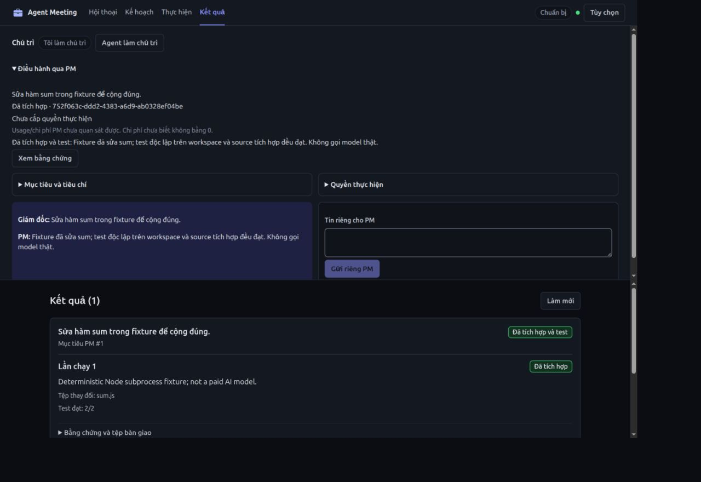

# PM điều hành — bằng chứng và giới hạn, 2026-10-22

Base Git `e292fd3`, mọi thay đổi giữ chưa commit. Giữ nguyên thay đổi CLI/skill có sẵn. Không gọi model/CLI trả phí, không chỉnh settings global hoặc app3000, không cập nhật bản cài local.

**Cập nhật kiểm chứng hiệu quả:** xem [PILOT.vi.md](PILOT.vi.md) cho case công việc repo thật, input/acceptance khóa, ledger đủ chi phí/công giám đốc và sửa overhead state/wait. Chưa chạy model, không thay kết luận fixture sum lịch sử dưới đây bằng kết luận tiết kiệm. API cursor không đổi dữ liệu trang host/UI.

## Pain point, kết quả và điểm dừng

Giám đốc muốn giao mục tiêu qua PM, không bấm host từng bước run/verify/integrate. Trước đây chỉ có worker slot và prompt đề xuất, chưa có PM capability. Lát cắt mới: Tôi mặc định; Agent sinh lời mời riêng → Node client PM join → đối chiếu mã/xác nhận → mục tiêu/acceptance → grant → plan cùng task UUID → managed worker copy riêng → tests độc lập → tích hợp một file và test source → report có evidence. Người dùng quan sát, dừng, thu hồi, đổi mục tiêu hoặc tiếp quản; giữ history sau reload/restart/takeover. Không thêm scheduler, DAG hay reviewer model.

Đủ trong phạm vi kỹ thuật: một task nhỏ qua được toàn hành trình bằng fixture xác định; các chốt quyền/lỗi/phục hồi có test; UI nguồn task/run thống nhất. Chưa tự nghiệm thu UX thay người dùng, chưa chứng minh lợi ích model/cost thực.

## Hợp đồng đã cưỡng chế

- PM local-only có logical ID, token hash, generation, invitation10 phút, pending/code, approval và lease120 giây. CLI tự mở bên ngoài; state/wait duy trì lease; server không khởi chạy PM/model. PM không dùng hostKey, không thành worker, không tính quorum. Model PM là tự khai báo; actual worker model vẫn kiểm qua WorkManager.
- Host local cấp goal revision/PM generation hiện hành, workspace Git/base, write paths, immutable tests, profile/model/config revision, risk, expiry và 1–3 run. PM không probe/config/remote/commit/push/deploy. Không fallback model âm thầm. Grant có ID; grant mới không nhận verify/integrate/report của run cũ. Replan đổi scope giữ task UUID và tăng requirementRevision.
- Chi phí chưa biết mặc định chặn run. Explicit unknown-cost consent + số lượt không phải trần tiền cứng. Failed launch cũng tiêu hao reservation; không retry ngầm. Usage/cost PM ngoài server chưa quan sát được; null không là0.
- Private channel không vào room log/minutes/webhook/worker history; pending PM không đọc private history/grant. Chỉ chia sẻ goal/acceptance được giao cho worker, không copy hội thoại riêng. Dữ liệu PM nằm trong kho WorkManager hiện có; không có bảng task thứ hai.
- Goal change làm nguồn cũ stale, xóa grant/report và yêu cầu cancel. Pause/revoke/lost/takeover chặn hành động tiếp theo và abort controller run của PM; trạng thái cancelled/interrupted/rollback thực vẫn do WorkManager ghi. Restart vô hiệu token/grant và không tự resume hoặc dispatch trùng. Revoke token không chứng minh CLI ngoài đã dừng. Required expert review/multi-file vẫn chặn tích hợp.
- Report chỉ completed khi run integrated; UI nói “Đã tích hợp và test”, không coi test tự động là nghiệm thu người dùng hay review chuyên gia.

## Kiểm chứng kỹ thuật

`npm test` đạt **265 test/26 file** bằng runner tuần tự, cgroup MemoryMax1200M/swap0, timeout900 giây cho lượt suite, heap768 MiB và giới hạn từng file của runner. Sau sửa chốt report theo grant và client localhost, chạy lại PM/i18n **18 test đạt** trên source cuối. Đây gồm test client mới; không cộng các lượt chạy lại thành số test khác nhau của toàn suite. Log: [suite](tests.txt), [kiểm cuối](final-targeted.txt).

Các ca PM gồm: một task idempotent; Node subprocess có sandbox ghi thật; model report → test workspace → source integration + test → report; báo done sớm chỉ blocked; private không lộ; worker/spoof/CSRF/tunnel bị chặn; PM vào trước quorum; mã xác nhận sai; unknown cost/unsafe paths/mutable tests/run limit; scope và profile/config pin; fail verification; required expert review; pause/revoke/takeover/goal change trong run; lost/restart; private history tồn tại sau actual persistence/server restart; grant mới chặn run cũ, replan giữ ID; Node PM client chạy thật qua localhost mà không launch model/settings. Test WorkManager có sẵn tiếp tục kiểm cancel trong verification/integration, source conflict, rollback, unverified model và isolation. Fixture không thay review model/chất lượng quyết định của PM thật.

`npm pack --dry-run --json` có `bin/pm.js`, `src/pm.js`, `src/ui/pm-ui.js`. Không cài package. `git diff --check` sạch.

## Browser trên bản tích hợp

Preview riêng: [PM fixture](http://127.0.0.1:3143/m/host_consistency_preview_1234?lang=vi#results), transient service `agent-meeting-pm-preview.service`, root `/tmp/am-pm-browser-preview`, chỉ fixture Node, bind127.0.0.1. Có thể dừng đúng service bằng `systemctl --user stop agent-meeting-pm-preview.service`; không liên quan cổng3000. Backend của preview luôn dùng deterministic runner, không được dùng để đánh giá model thật.

Đã thao tác: chọn Agent, lấy prompt riêng, chạy Node PM client join thực, nhập mã, giao mục tiêu và grant bằng UI; gọi plan/run/state/verify/integrate/report qua Node client; browser hiển thị kết quả cùng UUID và hai test đạt. Kiểm restart/lost đòi lời mời mới; grant không tự phục hồi; cuối cùng tiếp quản, reload và quay về mục tiêu riêng vẫn đọc được lịch sử.

Đã sửa lỗi “Việc #undefined” và link hội thoại sai cho origin PM; nhãn nay là Mục tiêu PM #revision, nguồn dẫn `#pmControl`, mở disclosure và đưa focus vào summary. Giữ các nguồn meeting-action cũ.

Đã kiểm VI/EN, system-dark và theme-light, 375/768/1280 **CSS px thực** bằng đo DOM (đã bù zoom của browser), không tràn ngang. Back/results/plan/deep link/reload giữ task count/ID, không tự dispatch; form/label và focus summary có kiểm. Console/CSP không có lỗi ở lượt nạp thành công cuối. Có một lỗi fetch trong lúc process preview tạm dừng; đã khôi phục bằng service riêng và kiểm lại. Chưa kiểm mọi screen reader, thiết bị vật lý hoặc mọi tổ hợp zoom/theme/state; chưa có phản hồi chấp nhận UX của người dùng.

Ảnh bổ sung: [desktop tiếng Anh, theme sáng](desktop-results-en-light.jpg), [mobile kết quả](mobile-results.jpg). Ảnh mobile là mốc trước khi đổi nhãn done thành “Đã tích hợp và test”; ảnh desktop cuối phản ánh nhãn hiện hành.

## Đối chứng với coding CLI trực tiếp

Cùng objective `Correct sum`, cùng input lỗi `a-b`, acceptance `sum(2,3)=5`, cùng immutable test và output byte giống nhau. Chạy `tools/measure-pm.js`: direct fixture sửa source bằng một Node subprocess rồi test; PM fixture dùng một worker subprocess trong copy riêng, verify, integrate/test source, report. Không có model PM hoặc worker thật. Direct fixture là mô phỏng hợp đồng coding CLI, không phải một lần gọi coding CLI/model thực.

[fixture-comparison.json](fixture-comparison.json) ghi byte/token/hash, thao tác, wall time của mẫu và giới hạn. Bộ đếm tiktoken0.14.0 local, không thêm dependency runtime. Tái hiện: `node tools/measure-pm.js` rồi đưa JSON stdout vào `tools/count-context-tokens.py` bằng venv tiktoken riêng. UUID/timestamp/output test khiến byte/hash/token có thể khác giữa các lần đo.

Mẫu cuối: direct **149 / 154 token** (cl100k/o200k); PM+worker **2584 / 2643 token** ở phần payload đã đếm. Direct 309ms, PM 623ms; một lần đo Node fixture, không là benchmark thời gian/model hay tổng billing. PM có 6 operation: plan, run, state, verify, integrate, report; hai test so với một test direct. Mẫu cho thấy overhead tăng.

Chưa đo tổng model turns, reasoning/output, hidden prompt, cache/billing, prompt mời PM, CLI PM bên ngoài, probe/setup, retry/fix/review, công/thời gian giám đốc hoặc chi phí bảo trì. Không suy elapsed của Node fixture thành độ trễ model. Không dùng fixture giảm payload của lát cắt CLI trước để khẳng định PM tiết kiệm.

Lợi ích có bằng chứng: PM credential thực hiện được run/verify/integrate/report và app lưu scope/provenance/cancel/evidence có thể giám sát, không cần host bấm từng bước sau grant. Chi phí bù lại: invitation/confirmation/goal/grant ban đầu, thêm API/checkpoint/lease, thêm kiểm chứng copy và PM CLI ngoài. Với việc sum, direct CLI đã có thể nhận một mục tiêu và làm; **chưa chứng minh PM giảm tổng công, token, tiền hoặc tăng chất lượng**. Giữ Tôi mặc định, không thêm lớp/agent để bù một lợi ích chưa được đo. PM là lựa chọn khi người dùng cần cơ chế ủy quyền/quan sát và bằng chứng lưu tại app.

## Phép thử model còn cần quyền riêng

Trên hai checkout tạm từ cùng source/input/acceptance, chạy direct coding CLI và PM+worker bằng model/profile xác định, không fallback, cùng tiêu chí source/test. Task low-risk một file, không cần reviewer model; max1 worker run, timeout120 giây/run, test30 giây/tệp, grant một giờ; không đặt deadline tổng. Ghi thời gian và số lần giám đốc can thiệp **kể cả setup**, chất lượng/code/test, requested/actual model, usage/cost/cache của direct, PM, worker và mọi retry/review; phần client không cho usage giữ unknown và đối soát nguồn billing thực. Nếu test fail hoặc cần quyết định vượt grant, báo blocked, không tự tăng vòng hay chi tiền.

Quyền còn thiếu: gọi CLI/model trả phí và phạm vi/ngân sách phép thử cụ thể. Không tự chạy phép thử hoặc sửa settings global. Các phần reviewer acceptance, multi-file, process reconciliation/resume và cách ly secret/network đầy đủ chưa triển khai, giữ nguyên giới hạn WorkManager. Dừng ở đây cho phạm vi đã được phép.
